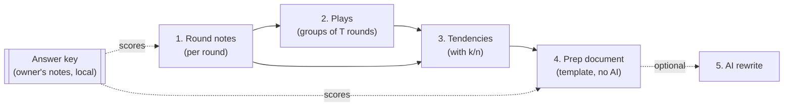

# The prep document: design

| Field | Value |
|---|---|
| Status | **Agreed** with the owner on 2026-11-17. Step 1 (round notes) is partly built: PR #16. |
| Replaces | The AI brief as the app's main output. The brief stays, as an optional rewrite (step 5). |
| Related | [Target design](target-design.md) §6.3 (pattern mining) and §6.5 (AI brief). [Delivery plan](../delivery/delivery-plan.md) §9 (work units PD-0 to PD-7). |

Labels, as in the target design: **[P]** proposed, **[OPEN]** not decided yet.

## 1. Goal

The owner wants the app to read an opponent's demos and write a **prep document**. Their team reads it before a match to know what to expect. In effect, the app rebuilds the opponent's stratbook: each play with its setup, utility, timing, lurker, variations and reactions, plus their CT setups.

The owner's layout (an example for Mirage):

- **T side:**
  - what they always do (for example, window and connector smokes every round);
  - pistol round;
  - each execute, with its hit time (B execute about 1:25, A execute about 1:20);
  - the mid default;
  - after-plant play per site.
- **CT side:**
  - pistol round;
  - defaults on A, mid and B;
  - retakes (for example, they prefer to save);
  - ecos and forces.

## 2. Principles

- **Code does the watching and counting. AI only helps with the wording, and it is optional.** Today, Claude reads every round story (about 90 for 4 demos), then spots the plays, counts them and writes them up in one go. The result changes from run to run, and its counts can't be rechecked. Code does the same work the same way every time, at no cost, and every line can be recounted.
- **Every line of the document traces back to its rounds,** with k of n (it happened in k of n rounds), like every finding today (test T-05).
- **A playbook names plays. It never forces a round into one.** A group of rounds that fits no known play stays a **"New play"** with its own description. A new play is often the most important line in the document.
- **The owner's hand-written notes are the answer key.** Every change to steps 1–4 is measured against them (§6).
- **Same demos and settings, same document** (test T-09).

## 3. The pipeline



None of this needs the demos to be parsed again. The data is already stored for every round:
- each player's position 4 times a second, with weapon, health and whether they carry the bomb;
- every grenade, with throw and landing points and times;
- all kills and damage, and who was flashed;
- the bomb events and each team's buy.

### Step 1: Round notes

Round notes are what the owner would write while watching a demo, written by the app instead. (The owner's own notes are the answer key, §6.) The code calls each one a round story. They live in `core/round_story.py` and are saved per version as `stories.json`.

**Built (PR #16):**
- each player's route, until they die or the bomb is planted;
- the T hit (the moment the Ts commit to a site), who is on it, and who is away from it;
- every kill, with places, weapon and trade.

**Still to build (PD-2):**
- **A label per round,** like "B execute 1:25", "Mid default, late A" or "no clear hit". Once plays exist (step 2), a T round's label names its play.
- **First damage,** not just kills, so "they fight early in mid" can be measured.
- **The CT side and the after-plant, per round.** The app already finds rotations, retakes, saves and after-plant setups, but only as patterns across rounds (`ct.rotation`, `ct.retake`, `ct.save`, `ts.postplant`). Each round's note should say what happened in that round. It should use the same per-round observations as the patterns, so there is one source for both.

**Corrections:** the owner can correct a round's label in the Rounds tab (#2). A correction shows where a rule is wrong.

### Step 2: Plays

**[P]** Group the T rounds into plays. Start from the existing strategy grouping (`ts.strategy`: by site and hit-time band, then by similar setups). Add each player's route and the key utility, so "3 through short" is a signal, not just "3 at short at 1:25".

- **The lurker** is the player who is away from the group at the hit. Round notes already use this rule:
  - alive and off the hit's site;
  - more than 1,200 units from every teammate who is on it.

  It was calibrated on only 21 cases from 4 demos, so the answer key will be used to tune it. A play's lurker is whoever is most often away in its rounds, and where they are.
- **A playbook file per map** names the groups by their signals (what you can see in the rounds):
  - which smokes and mollies, and where they land;
  - where most of the team goes, and through which places;
  - what may differ, with the rule "the odd one out is the lurker".
- **Naming:**
  - A group takes a play's name only if most of its rounds meet that play's signals.
  - Otherwise it is a **"New play"** with a description built from its signals, for example "B via underpass and apps, 3 rounds, no window smoke".
  - The owner can rename any play. The name survives recomputes through the existing label matching: an old and a new play whose rounds overlap by at least half (Jaccard ≥ 0.5) count as the same play (target design §6.3).
- **Keep the playbook general:** standard plays for the map, not plays seen from one team. Otherwise it only repeats what the owner already knows.

A playbook entry might look like this. The exact format is decided in the issue. Places use the map's own place names. `ai/callouts.json` maps them to the owner's callouts (`SnipersNest` is the window, `Catwalk` is short).

```json
{
  "map": "de_mirage",
  "plays": [
    {
      "name": "B split",
      "site": "B",
      "pace": "execute",
      "utility": [{"type": "smoke", "at": "SnipersNest"}, {"type": "smoke", "at": "Connector"}],
      "routes": [{"through": "Catwalk", "min_players": 3}, {"through": "Apartments", "min_players": 1}],
      "lurker": "allowed"
    }
  ]
}
```

**[P]** The playbook is a data file per map, next to `ai/callouts.json`. It is loaded outside `core` and passed in, so `core` stays pure (lint-imports).

### Step 3: Tendencies

A tendency is a count turned into a fact about the team, such as "usually hits B around 1:25". Each one keeps its k of n and links to the rounds behind it. Low counts carry the existing low-sample flag.

**Most kinds already exist as findings** (v1 and the economy reads, #6): T and CT setups, sites, tempo, fakes, rotations, retakes, saves, after-plant setups, player habits, roles and weapons, lineups, and pistol, eco and force reads. The delivery plan's PD-4 lists the exact kinds.

**What's new:**
- gathering them **per play**, counted again on the play's rounds;
- a few missing kinds: reactions to the first fight, "like clockwork" utility (the same player throws the same grenade at the same spot at the same time, in 80% of rounds or more), and peeks after a player's own utility.

Tendencies come at four levels:
- **per play:** the usual setup, utility in throw order, the hit time, the lurker, and what changes after the first fight;
- **across a side:** what they do every round, such as the same smokes, and CT setups per site;
- **per player:** "like clockwork" utility, peeks, AWP spots, early fights, and how much a CT anchor moves around;
- **per situation:** pistol rounds, ecos and forces, the after-plant, retakes and saves.

#### How each line of the example layout gets found

| Line in a prep document | What the app measures |
|---|---|
| Always window + connector smokes | Smokes by landing spot, across all T rounds |
| B execute: hit around 1:25 | When 3 or more players commit to B, or the execute utility lands, and the typical time across the play's rounds |
| 4 in apps at 1:40, the fifth at TV or mid joins apps | Positions at 1:40, then each player's route up to the hit |
| Window and door smokes, car mollies, flashes over B | Utility within ±10 s of the hit, in throw order |
| 1 mid lurk, or 2 palace | Who is away from the group at the hit, and where |
| Often stall if they lose the first duel | Hit time and hit rate after winning versus losing the opening fight |
| After-plant A: fight for CT, never ramp or apps | Positions 10 s after the plant, and where their after-plant fights happen |
| Throws ramp molly, mid flash, palace smoke "like clockwork" | Same player, same grenade, same spot, same time, in 80%+ of rounds |
| Loves to peek ramp after the molly | That player's damage at ramp within a few seconds of their own molly |
| AWP in window, peeks early | Weapon, spot, and when their first fight happens |
| Fights early in mid and connector, usually wins | Fights before 1:30 by player and place, and how many they win |
| B anchor alone, switches position a lot | CT count per site, and how spread out one player's spots are |
| Retakes: prefer to save | After a plant: CTs who move away from the site and survive without fighting |
| Eco: stack together, no utility. Force: 3 aggressive mid | Buy type, then setup, utility thrown and early fights |
| Pistol: 1 A, 4 B; once the B players went under to A | Pistol rounds kept apart; a one-off is listed as "once", with a round link |

### Step 4: The prep document

**[P]** The document is filled in from the tendencies, in the owner's layout (§1), without AI.

- **Counts become words:**
  - **"always":** 90% of rounds or more;
  - **"usually":** 65% or more;
  - **"sometimes":** 20% or more;
  - **"once" or "twice":** a rare variation worth knowing.

  **[P]** The thresholds live in `AnalysisConfig`, so they can be tuned without a re-parse.
- **The numbers move to an appendix:** k of n, and links to rounds.
- **The owner can edit it,** then print or export it, using the edit mode and print layout that #1 builds for the brief.
- **[OPEN]** Where it lives in the UI: a new tab per analysis, or in place of the AI brief tab.

### Step 5: AI rewrite (optional)

Claude reads the tendencies and the draft document, not every round. Each run should be cheaper and more consistent than today's brief. PD-6 compares the cost.

- **What it is for:**
  - merging lines and putting the important ones first;
  - writing counters ("no need to re-peek if you get the entry");
  - describing an unusual round in the owner's words ("full W strat").
- **What it can't do:** anything that isn't in a demo, such as comms, intent, or fakes that look like real hits.
- **What stays the same:**
  - the preview and confirmation before anything is sent (FR-AI-2);
  - the grounding check, so every line still cites its tendency or rounds (FR-AI-3).

## 4. Where it lives in the code

| Piece | Where | Notes |
|---|---|---|
| Round notes and labels | `core/round_story.py` | Exists. Labels, first damage and the CT lines are added (PD-2). |
| Plays | `core/plays.py` (new) | Builds on `ts.strategy` in `core/patterns_t.py`. |
| Playbooks | a data file per map, next to `ai/callouts.json` | Loaded outside `core`. |
| Tendencies | `core/tendencies.py` (new) | Mostly recounts existing findings per play (PD-4 lists them). It adds only the missing kinds. |
| Prep document | a web template and the export | Rendered from the Findings Snapshot, like every other output. |
| Answer-key scorer | `tests/`, marked like G-demos | Reads key files from `tests/local_fixtures/`, which git ignores. |

Plays and tendencies go into the Findings Snapshot, which stays the single contract for the UI, the export and the AI (target design §1). Each step that changes it bumps `SCHEMA_VERSION`.

## 5. Callouts finer than place names

The map only has places like "House", "Shop" and "Truck". The owner's callouts are finer (TV, window, door, car, balcony), and plays are described at that level ("door smoke", "car molly").

- **[P]** Trace the owner's callouts as areas onto the radar, from the owner's labelled radar images. Then show an overlay so the owner can check them.
- This is the "PolygonZones" trigger in the target design §11.
- This is part 2 of the callouts. Part 1 is #3: callouts in place of place names everywhere, a glossary per map and a workspace override. It maps a whole place to one callout, and the areas build on it.

## 6. Quality: the answer key

The delivery plan's review (§8) accepted that nothing automatic checks pattern quality. The answer key does that: the owner's own notes on real games, which the app is scored against.

**What the owner provides** (PD-0, issue #30 has the steps):
- **Round-by-round notes for 3 pro demos** (the most valuable part). Same team, same map, same five players; recent; ideally against three different opponents.
- **A summary:** their tendencies and "what to expect" for that team. This is the target for the prep document's content and layout.
- **Radar images with their callouts,** for §5.
- **Optional: a list of standard plays** with their signals, as a starting playbook. It names groups; it never limits them (§3, step 2).

**Writing the notes so they can be scored:**
- **Header:** the round number as the demo counts it, then the side, the buy if it wasn't a full buy, and the play name.
- **One name per play,** the same every time the play comes back. That is how the stratbook takes shape.
- **Round-timer times** (1:25, not "40 seconds in").
- **Mark doubts** ("fake?", "looked like a stall"). Those are the rounds the app will struggle with too.
- **Round numbers in the summary** where you can: "B execute ~1:25 (R3, R6, R9)".

**How it's used:**
- **[P]** The notes are turned once into a key file per demo: round → play, site, lurker and key facts. The owner checks the key file.
- **Round score (automatic):** each owner play name is matched to the app's play with the most of its rounds. The score is how many rounds agree, for example "the app matches your play on 41 of 45 rounds; it missed the lurk in R7 and R15". Site and lurker are scored separately.
- **Document score (owner, about 10 minutes):** how many of the owner's summary lines the app's document contains, and how many of the app's lines the owner would keep. The scorer prints both lists as a checklist, because free text can't be matched reliably by code.
- **Tune on 2 demos, test on the 3rd.** If the app only gets good on the demos it was tuned on, it has learned those games, not how to read a team.

**Rules for a fair test:**
- **Write blind:** don't open the app's results for those demos until the notes are done.
- **Import first:** load the demos into the app before writing notes, just to check they parse. Pro demos come from a different source than FACEIT, and that is untested.
- **Keep it all local:** notes and key files go in `tests/local_fixtures/` or next to the demos, never in the repo. They tie player names to demos that contain SteamIDs. Scoring runs locally, like G-demos.
- **One team tunes the app to that team's style.** Notes on a second team or map later show whether the rules hold up.

## 7. Limits

- With 4 demos, a play may appear only 3 or 4 times, so some lines are a "probably". The low-sample flag shows which.
- Fakes and mid-round calls will sometimes get the wrong label. That is why the owner can correct labels (#2).
- Teams change their strats. The document is a starting point, not certainty.
- Neither the code nor the AI can see comms or intent.

## 8. Build order

The work units (PD-0 to PD-7), their order and two milestones are in the [delivery plan](../delivery/delivery-plan.md) §9. In short:

1. **Round notes (PD-2) and the owner's notes (PD-0),** at the same time. The scorer (PD-1) follows the owner's notes. Corrections go through the Rounds tab (#2).
2. **Plays,** with the playbook and lurkers (PD-3). Milestone M4: plays scored against the answer key.
3. **Tendencies** (PD-4).
4. **The prep document,** without AI (PD-5). Milestone M5: the owner reads it for a real opponent.
5. **The AI rewrite** on top (PD-6).

Callout areas (§5, PD-7) can be built at any point after #3, once the owner's radar images exist. The 2D replay (#4) is the quick way to check a round.
