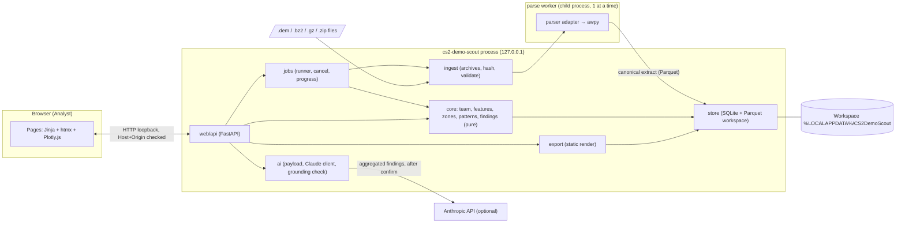

# CS2 Demo Scout — Target System Design

| Field | Value |
|---|---|
| Status | **Accepted** by the owner on 2026-11-15. ADR-002 and ADR-006 are conditional on spike S-1; see §9. |
| Owner | Repository owner |
| Inputs | [Product requirements](../product/requirements.md) (FR-\*, D1–D8, DEP-\*, C-\*, Q1–Q7) and [System design baseline](system-design-baseline.md) (DRV-\*, QS-\*, U-\*) |
| Current state | Greenfield. The repository contains docs only. Prior art: the owner's `ESEA-Analyst` project used `demoparser2` for kill events. No code from it is reused. |
| Diagrams | [Workflows](../workflows/README.md): the flows and state machines as built. |

**Labels used in this document:**
- **[F]** fact, from a cited source.
- **[A]** assumption.
- **[E]** estimate.
- **[P]** proposed decision.
- **[OPEN]** unresolved.

---

## 1. Design summary

**[P]** The app is a **single-process modular monolith** in Python. It runs on `127.0.0.1` only.

- A **FastAPI** server renders HTML pages with **Jinja2**.
- **htmx** handles partial page updates.
- Python builds **Plotly** figure specs, and the browser only displays them.
- Demo parsing uses **awpy 3.x** behind our own adapter. Each demo is parsed in a **separate child process**.
- Library metadata lives in **SQLite**. Per-demo extracted tables live in **Parquet** files.
- Every analysis produces one versioned **Findings Snapshot**. It is the single contract for the UI, the export, and the AI brief.
- An export renders the same templates in "static" mode. Every asset is inlined into one HTML file.



**Changed 2026-11-21 (agreed with the owner on 2026-11-17):** the app's main output becomes a **prep document**, in place of the AI brief.
- Code builds it in four steps: round notes, then plays (with lurkers, named from a per-map playbook), then tendencies with k/n, then a templated document.
- AI becomes an optional rewrite on top.
- Plays and tendencies join the Findings Snapshot, which stays the single contract.
- The owner's hand notes on 3 pro demos are the answer key it is scored against.
- The details are in the [prep-document design](prep-document.md), and the work units in the delivery plan §9.

## 2. Drivers that shape this design

| Driver | Design response | Section |
|---|---|---|
| DRV-1 correctness | Use awpy's tested metrics. Run a reference-demo test suite. Derive everything else from one canonical extract. | §5, §10 |
| DRV-2 traceability | Every finding carries `round_refs`. The Findings Snapshot is the only output contract. | §5.4 |
| DRV-3 parser churn | Adapter port plus our own canonical schema. Parsing runs in a child process. Extracts are versioned by parser and schema. | §5.2, §6 |
| DRV-4 no re-parse | Cache key = (sha256, parser_version, extract_schema_version). Features and patterns are recomputed from the extract only. | §5.2, §5.3 |
| DRV-5 local-only | Loopback bind, Host and Origin checks, a single outbound client, payload preview. | §8 |
| DRV-6 self-contained export | One renderer, two modes. A static mode inlines Plotly.js and the images, and adds a CSP that blocks all network access. | §5.6 |
| DRV-7 map geometry | Map assets come from a pinned awpy-data version. A `ZoneProvider` port allows place names now and polygons later. | §5.5 |
| DRV-8 pattern quality | Deterministic algorithms with thresholds that can be configured. Pattern identities stay stable across recomputes. | §6.3 |
| DRV-9/10 durability, idempotency | Versioned entry states with an atomic pointer swap. Demo identity is a content hash. | §5.3, §6.1 |
| DRV-11 hostile input | Bounded, name-agnostic decompression to a temp file. Validation before parsing. Parsing in a child process. | §6.1 |
| DRV-14 speed: not applicable | Parse **sequentially**, one child process at a time. This trades speed for low memory and simplicity. | §3 |

## 3. Estimates

Variables:
- D = demos per entry, **3–50** [A, baseline §3].
- R = rounds per demo, **13–30**, overtime included [A].
- T = live match minutes, **30–60** [E].
- Snapshot stride is **16 ticks**, which is 4 Hz at a 64-tick recording [A: verify in spike S-1].

| Quantity | Formula | Range [E] | Decision sensitivity |
|---|---|---|---|
| Rounds per entry | D × R | 39 – 1,500 | Clustering stays O(n²): at most 2.25 M pair distances. Trivial at this size. |
| Snapshot rows per demo | 4 Hz × 60 × T × 10 players | 72 k – 144 k | Defines extract size. A stride of 8 doubles it, which is still fine. |
| Extract size per demo (all tables) | rows × ~30–60 B compressed + events | 5 – 15 MB. **Measured in S-1: 1.6–2.9 MB.** | — |
| Extract size per entry | D × above | 15 MB – 750 MB | — |
| Retained source copy per demo | 208–361 MB × gzip ratio 0.72 [F, measured 2026-11-15 on a 50 MB sample; zstd is not in the Python 3.13 standard library] | 150 – 260 MB | **First bottleneck: disk.** Demos are deduplicated across entries by sha256. |
| Library worst case | 20 entries × 50 demos × 150 MB | ≤ 150 GB | 597 GB free [F, ENV-3]. Show workspace usage. The cap can be configured (§7). |
| Findings Snapshot | ~50 heatmap grids × 64×64 cells + patterns | ~1–3 MB JSON | — |
| Exported HTML | Plotly.js (~4.6 MB) + radar PNG (~1–2 MB as base64) + data | ~7–12 MB | Fine to share via Discord or Drive. If too big, use the partial Plotly bundle. |
| Parse memory | one awpy parse | **Measured in S-1: 0.5–0.8 GB** on the production path. 5.4–9.1 GB if `ticks(players_only=False)` is used, so that call is banned in production (ADR-002). | Sequential parsing keeps the peak at one parse. 32 GB of RAM is available [F]. |
| Request rate | 1 user | negligible | No caching layer or queue infrastructure is needed. |

**Deferred on purpose:**
- parallel parsing,
- a task queue (Celery/RQ),
- DuckDB,
- a background daemon,
- a packaged `.exe`,
- a JS SPA framework.

§11 lists what would trigger each of these.

## 4. Modules and dependency rules

```
cs2scout/
  core/            # PURE: Polars in, dataclasses/Polars out. No I/O. No awpy/fastapi/sqlite imports.
    schema.py      # canonical extract schema (column contracts), version constant
    team.py        # roster detection, side labelling (FR-TEAM-*)
    rounds.py      # round classification (FR-RND-*), configurable buy thresholds
    zones.py       # ZoneProvider port + PlaceNameZones (+ PolygonZones later)
    features.py    # per-round & per-player-round features (FR-TS/CT/UTIL/PLR)
    patterns.py    # setups, strategies, lineups, habits clustering (deterministic)
    findings.py    # Findings Snapshot schema, assembly, filter recount (FR-CONF-*)
    config.py      # AnalysisConfig (Q1–Q3 thresholds), hashed into snapshot
  parser/          # port + awpy adapter; only place that imports awpy
  ingest/          # file discovery, bounded archive handling, hashing, magic bytes, retention
  store/           # workspace layout, SQLite repositories, Parquet IO, atomic swaps
  jobs/            # job runner, child-process parse/probe, import_job (J1/J2 orchestration),
                   # analysis (team resolution, recompute S3-S6, version swap)
  web/             # FastAPI app, routes, templates, Plotly figure builders, security middleware
  export/          # static render + inliner
  ai/              # payload builder, Anthropic client wrapper, grounding validator
```

**Dependency direction** [P]: `web → (jobs, export, ai) → (ingest, store, core) → core/schema`. `parser` depends only on `core/schema`.

- An import-linter contract enforces that `core` imports nothing from the other packages.
- An import-linter contract enforces that only `parser` imports `awpy`.

**Invariants:**
- **I-1:** Findings are a pure function of (extracts, roster overrides, AnalysisConfig, zone provider version). The same inputs give a byte-identical snapshot.
- **I-2:** Every aggregate number in a finding can be recomputed from its `round_refs`.
- **I-3:** No SteamID leaves the process, except in the local UI.

## 5. Data and contracts

### 5.1 Workspace (system of record)

The root is `%LOCALAPPDATA%\CS2DemoScout\`. The setting `CS2SCOUT_HOME` overrides it.

```
library.sqlite                   # metadata, overrides, entry versions, AI briefs
demos/<sha256>/source.dem.gz     # retained source copy, gzip level 6 (setting; default ON, ADR-003)
extracts/<sha256>/<parser>@<ver>+s<schema>/*.parquet
entries/<entry_id>/v<n>/findings.json, grids.parquet, features.parquet
assets/awpy-data/<version>/      # AWPY_DATA_DIR, pinned
tmp/                             # decompression scratch; wiped on start
logs/app.log                     # rotating
```

**SQLite tables** (architecture depth):

| Table | Purpose |
|---|---|
| `demo` | sha256 (PK), match_key, map, played_at, rounds, status, source_retained, original_path?, imported_at |
| `extract` | sha256, parser_name, parser_version, schema_version, path, row_counts, warnings |
| `team` | team_id, display_name. Shared across maps (FR-LIB-5). |
| `team_player` | team_id, steamid, role, last_nick. `role` is one of core / standin / excluded (FR-TEAM-2/5). |
| `entry` | entry_id, team_id, map, current_version, created/updated |
| `entry_demo` | entry_id, sha256, included, team_assignment_override |
| `entry_version` | entry_id, n, config_hash, input_hash, created_at, status. `status` is one of building / ready / failed. |
| `label` | entry_id, pattern_kind, stable_key, user_label. Covers user renames (FR-TS-3) and role overrides (FR-PLR-1). |
| `ai_brief` | entry_id, entry_version, created_at, model, payload_hash, brief_json, stale flag |
| `job` | job_id, kind, state, progress, per-demo results, error |

**Lifecycle:**
- A demo is deleted from the workspace when no entry references it. This is a garbage collection run after an entry is deleted or a demo is removed, and it asks the Analyst to confirm.
- Entry versions keep only `current` and `current-1`. Older versions are pruned after a successful swap.

### 5.2 Canonical extract (parser → core contract)

`core/schema.py` defines the extract. Its version constant is `EXTRACT_SCHEMA = 1`. Every adapter must produce these tables:

| Table | Key columns (abridged) | awpy source [F, awpy docs 3.3] |
|---|---|---|
| `header` | map, tick_rate, match_key, played_at?, client_version | `demo.header` |
| `players` | steamid (u64), name, team_clan_name | `demo.players` |
| `rounds` | round_num, start/freeze_end/end tick, winner_side, reason_name, is_knife, is_warmup, is_ot | `demo.rounds` |
| `round_economy` | round_num, side, equipment_value, n_players (+ awpy buy_type for reference only) | `demo.round_economy` |
| `kills` | tick, attacker/victim/assister steamid + side + xyz, weapon, headshot, thrusmoke, is_trade, victim_traded | `demo.kills` |
| `damages` | tick, attacker/victim steamid, dmg_health, weapon | `demo.damages` |
| `bomb` | tick, event, steamid, bombsite, xyz | `demo.bomb` |
| `grenades` | entity id+serial, thrower steamid+side, type, start_tick, end_tick, throw xyz, land xyz (derived: first and last points of the trajectory) | `demo.grenades` |
| `smokes`, `fires` | start/end tick, xyz, thrower | dataset intervals |
| `blinds` | tick, attacker, victim, duration | `demo.blinds` |
| `snapshots` | tick, steamid, side, x,y,z, yaw, health, active_weapon, place | `demo.snapshots(every=16)`. `place` comes from the `ticks()` raw field `m_szLastPlaceName`, joined on (tick, steamid) [F, S-1: never empty]. |
| `server_counters` | steamid, kills, deaths, assists, damage (last value per player) | `ticks()` raw fields `m_pActionTrackingServices.m_matchStats.m_iKills/m_iDeaths/m_iAssists/m_iDamage` [F, S-1]. Read in the same `ticks()` call as `place`. Used for the import sanity check (§6.1 step 6) and T-01. |

**Rules:**
- `src/cs2scout/core/schema.py` is the authority for exact columns, dtypes and row order. The table above is a summary. As built, `grenades` stores one row per trajectory (throw point, landing point, `land_tick`), and the extract holds parser facts only: no derived flags such as overtime or warmup.
- Columns that cannot be filled are nulls, never guesses.
- The adapter records a `warnings` list, e.g. `place unavailable` or `grenade owner unresolved: 3`.
- Buy class is **computed by `core.rounds`** from `equipment_value` with configurable thresholds (FR-RND-1, Q1). awpy's fixed `buy_type` is kept for cross-checking only.

### 5.3 Pipeline stages and caching

| Stage | Scope | Input → output | Cache / recompute rule |
|---|---|---|---|
| S1 Ingest | per file | path → validated `.dem` in tmp + sha256 + header | none |
| S2 Extract | per demo (child process) | `.dem` → canonical Parquet | Skipped if `extract(sha, parser@ver, schema)` already exists (DRV-4) |
| S3 Team resolve | per entry | players + rounds of all included demos + overrides → roster, per-demo team side map | Always recomputed. Cheap. |
| S4 Features | per entry | extracts + S3 → `features.parquet` (round rows, player-round rows) | Recomputed per entry version |
| S5 Patterns | per entry | features → pattern sets with stable keys | Recomputed per entry version |
| S6 Findings | per entry | S3–S5 + heatmap grids → `findings.json` (schema v1) | Recomputed per entry version |
| S7 Filter view | per request | findings + filter → recounted view | In memory, memoized per (version, filter) |

**Atomic entry update** [P]:
1. S3–S6 write into `entries/<id>/v<n+1>/` while `entry_version.status = building`.
2. On success, one SQLite transaction sets `entry.current_version = n+1`.
3. On failure or cancel, the job deletes `v<n+1>` and leaves `current` untouched (DRV-9, QS-6).
4. On startup, any `building` versions left over are deleted.

### 5.4 Findings Snapshot (the single output contract)

```jsonc
{
  "schema_version": 1,
  "entry": {"id", "team", "map", "version", "generated_at", "config_hash", "input_hash"},
  "demos": [{"sha", "label", "played_at", "rounds", "incomplete", "included"}],
  "roster": [{"player_key", "nick", "role", "is_standin"}],   // player_key = stable local id, NOT steamid
  "round_index": [{"ref", "demo", "round_num", "side", "buy", "opp_buy", "score", "won", "end_reason", "played_at", "is_ot"}],
  "findings": [{
      "id": "ts.strategy.7f3a",          // kind + stable_key
      "kind": "ts.strategy | ts.default | ts.tempo | ct.setup | ct.position | util.lineup | plr.habit | plr.stats | ...",
      "subject": "team | <player_key>",
      "title": "B fast exec ~0:25, 3 smokes",   // auto title; user label overlays
      "params": {...},                   // kind-specific facts (site, timing band, positions, utility set)
      "eligible": {"side": "T", "buy": ["full"]},
      "round_refs": ["d3:r14", ...],     // members (I-2)
      "support": {"k": 7, "n": 22, "demos": 4},   // computed, never stored independently of round_refs
      "outcome": {"won": 5},
      "recency": {"last_seen": "2026-10-30", "share_last_3_demos": 0.4},
      "flags": ["low_sample"]
  }],
  "grids": {"<grid_id>": {"shape": [64,64], "extent": [...], "subject", "side", "phase"}}  // values in grids.parquet / inlined on export
}
```

- **Filter recount (S7):** patterns are mined **once on the full included set**. Filters for round type, demo subset, date range and overtime only:
  - restrict `round_index`,
  - recount `k/n`,
  - re-apply the minimum-support and low-sample rules (FR-CONF-1/2).
- This keeps strategy identities and user labels stable across filters. The trade-off: a pattern that appears only inside a filtered subset is not discovered. §11 has the trigger for revisiting this.
- **Player key:** the local `player_key` (e.g. `p3`) maps to a SteamID in SQLite only. Exports and AI payloads use the key and the nickname (I-3, C-2).

### 5.5 Map geometry and zones

- **[P]** A pinned `awpy-data` version supplies:
  - `map_data.json` (the world-to-radar transform),
  - `radars/<map>.png` (with `_lower` variants for Nuke, Vertigo and Train),
  - `navs/<map>.nav`.
- These live under `assets/awpy-data/<version>`, with `AWPY_DATA_DIR` set to that directory [F, awpy docs].
- awpy downloads missing assets automatically on first access [F]. The app must not trigger that at runtime (DRV-5). Instead, assets are installed by an explicit `cs2scout assets fetch` command, which downloads the pinned version and verifies it against the checksums in `manifest.json`. At runtime, map accessors are called with `version=` and the assets must already be on disk. Missing assets give the "stats only" fallback, never a download.
- A map with no assets falls back to "stats only" (DEP-2).
- **As built (WU-8):** pinned release `2000943`, verified against SHA-256 pinned in `store/assets.py`. Only `images.zip` and `map_data.json` are fetched; the collision and nav meshes (~65 MB) are not needed. The transform is `px = (x - pos_x) / scale`, `py = (pos_y - y) / scale` on 1024×1024 radars. Positions below `verticalsections.lower.AltitudeMax` use the `_lower` radar. Grids carry `space: radar|world`.
- `ZoneProvider` port: `zone_of(x, y, z) -> zone_id`, plus `zone_meta(zone_id) -> name, site, polygon?`.
  - **v1 `PlaceNameZones`:** uses the snapshot `place` value, plus a small per-map table that maps place names to sites and lanes. Example: `BombsiteB → site B`, `Banana → B lane`.
  - **Fallback if `place` is unavailable or too coarse (U-1/A2):** `PolygonZones`, using hand-authored callout polygons per map. Nav-area lookup through `awpy.NavMesh` is another option, if nav areas carry usable place data [OPEN].
  - The zone provider version is part of the input hash, so changing zones creates a new entry version.

### 5.6 HTTP surface (internal, loopback only)

The API is unversioned: there is a single client, the same release's templates. The Findings Snapshot and the export carry `schema_version`.

| Method + path | Purpose | Notes |
|---|---|---|
| `GET /` , `/entries/{id}/{tab}` | Pages (HTML + htmx partials) | Tabs: overview, t, ct, utility, players/{key}, demos, roster |
| `POST /api/imports` | Start an import job. Body: `{paths[]}` for folder or file paths on this PC, or a multipart upload. | Path import is the primary method: no copy through the browser, and the original path is remembered (FR-LIB-4). Upload is offered for drag-and-drop. |
| `GET /api/jobs/{id}` · `POST /api/jobs/{id}/cancel` | Progress and cancel | Polled by htmx every 1 s |
| `GET/PATCH/DELETE /api/entries/{id}` | Rename or delete (FR-LIB-2) | Delete requires a `confirm=<entry name>` field |
| `POST /api/entries/{id}/demos` · `PATCH /api/entries/{id}/demos/{sha}` | Add demos (J2). Include, exclude, or assign the team side (FR-TEAM-3). | Each change starts a recompute job |
| `GET/PUT /api/entries/{id}/roster` | Confirm or edit the roster (FR-TEAM-2) | — |
| `PUT /api/entries/{id}/labels/{finding_id}` | Rename a pattern or override a role | Survives recompute (§6.3) |
| `GET /api/entries/{id}/findings?side=&buy=&opp_buy=&demos=&from=&to=&ot=` | Filtered snapshot view (JSON) | Used by the AI payload preview and by tests. Pages use the same function. |
| `GET /api/entries/{id}/rounds?refs=` | Round list for a finding (FR-CONF-3) | — |
| `POST /api/entries/{id}/export` `{sections[], filter}` | Returns the HTML file as an attachment | §6.4 |
| `POST /api/entries/{id}/ai-brief/preview` → `{payload, token}` · `POST /api/entries/{id}/ai-brief {token}` | J5 | The token binds confirmation to the exact payload hash (FR-AI-2) |
| `PUT /api/entries/{id}/ai-brief` `{sections, based_on}` · `POST /api/entries/{id}/ai-brief/restore` | Edit the brief, or bring back Claude's original (FR-AI-5) | Each save is a new `ai_brief` row; nothing is sent to Claude |
| `GET /api/health` | Liveness: versions, workspace, disk usage | — |

**Error envelope:** `{code, message, detail?}`.

**Stable codes:**
- `DEMO_UNREADABLE`
- `NOT_CS2`
- `MAP_MISMATCH`
- `DUPLICATE`
- `ARCHIVE_REJECTED`
- `INCOMPLETE_MATCH` (a warning)
- `TEAM_NOT_FOUND`
- `PARSER_CRASH`
- `PARSER_TIMEOUT`
- `AI_DISABLED`
- `AI_UPSTREAM`
- `AI_UNGROUNDED`
- `CONFLICT_JOB_RUNNING`
- `FORBIDDEN`: the loopback guard refused the request (§8). Added in WU-0.

**Concurrency rule:** one job per entry at a time; a second request returns `CONFLICT_JOB_RUNNING`. Across the app, parses are serialized by a single parse slot.

## 6. Critical low-level design

### 6.1 Ingest and parse (J1/J2) — correctness, security and failure risk

1. **Discover.** Expand folders into `*.dem`, `*.dem.bz2`, `*.dem.gz` and `*.zip`. Ignore all other files.
2. **Decompress.** Stream into `tmp/<uuid>.dem` and never use the name stored in the archive.
   - **Bounds** (configurable): output ≤ 2 GB, compression ratio ≤ 50:1, and a zip holds exactly one `.dem` member, with no nested archives. Otherwise reject with `ARCHIVE_REJECTED` (QS-7).
3. **Hash.** sha256 of the decompressed bytes.
   - If the hash exists in `entry_demo`, report `DUPLICATE`.
   - If it exists in `demo` but not in this entry, reuse it. No parse.
4. **Header probe** in a child process, with a short timeout. Read the map name and the demo format.
   - Not PBDEMS2 → `NOT_CS2`.
   - Wrong map → `MAP_MISMATCH` (FR-IN-3).
   - A second duplicate check runs on `match_key` (server + match id + map, when available). It catches the same match with a different byte content, e.g. a re-encoded file (FR-IN-4).
5. **Extract** in a child process (`multiprocessing`, spawn start method, one at a time):
   - It writes Parquet files to `extracts/.../_partial/`, then renames the directory on success.
   - A timeout applies (configurable, default generous: 15 min; speed is not a goal).
   - A non-zero exit gives `PARSER_CRASH`. An exception gives `DEMO_UNREADABLE` with its message. The other demos continue (FR-IN-2, QS-2).
6. **Sanity checks** on the extract. As built in WU-2, `core.schema.sanity_issues`:
   - **Reject:** a required raw field came back all-null (`missing_fields`, ADR-002); no rounds; no players; no positions.
   - **Warn:** not 10 players (A1); no kills; no grenades; no server counters; no place names for alive players.
   - Per-player K/D/A against the server counters is checked in T-01 (G-demos), not on every import. It needs the counting rules from core (WU-7). WU-7 may add it as an import warning.
   - Incomplete-match detection under the MR12/overtime rule (FR-IN-5) belongs to round logic in core (WU-6), not to the extract.
   - An adapter that breaks the schema contract is a `PARSER_CRASH` (our bug), not a bad demo.
7. **Retain the source** (ADR-003). Compress the demo to `demos/<sha>/source.dem.gz` (gzip: standard library, ratio 0.72 measured), then delete any temp copy.
8. **Cancel.** The job sets a cancel flag. The runner kills the child process, deletes `_partial` and tmp files, and keeps completed extracts. The entry version is not created (J1 alternative).

### 6.2 Team resolution (FR-TEAM-1..5)

- **Per demo:**
  - Split the players into two **lineups**. A player's lineup is their side in round 1, so lineups stay fixed across side swaps.
  - Take each lineup's side per round from **observed** `team_num` at freeze end, not from a swap rule. S-1 saw a swap at round 13. In overtime there was no swap at round 25 and a swap at round 28 (n=1). Lineups never split across sides in 4 demos.
  - A round where a lineup's players are on different sides is flagged. This catches substitutions or a corrupted demo.
- **Core roster:** count each SteamID's appearances across demos, then run a co-occurrence check. The core is the largest set of players with ≥ 50% demo presence who share a lineup in those demos. At most 5 are core; the rest are stand-ins.
- **Scouted lineup per demo:** the lineup with ≥ 3 core players. If neither lineup qualifies, the demo is flagged `TEAM_NOT_FOUND` (FR-TEAM-3), and the Analyst can assign the lineup manually.
- **Bootstrap:** with 1–2 demos, no lineup can reach 50% presence across demos. The UI then asks the Analyst to pick a lineup.

### 6.3 Pattern mining (DRV-8) — deterministic

The thresholds below come from `AnalysisConfig`. The defaults are Q2 and Q3 from the product requirements.

- **Round time** = (tick − freeze_end_tick) / tick_rate.
- **T default setup (FR-TS-1):**
  - At checkpoints of 15, 30 and 45 s, take the multiset of zones of the scouted players still alive, recorded as zone counts.
  - The setup signature is the sorted zone-count tuple at the 30 s checkpoint.
  - Rounds with the same signature are grouped exactly. Groups whose signatures differ by a single player in a neighbouring zone are merged.
- **Site hit (FR-TS-2):**
  - Use the plant site if there is one.
  - Otherwise use the site zone with ≥ 3 attackers, or ≥ 2 smokes or mollies landing there, within a 10 s window.
  - Otherwise `unresolved`.
  - **Hit time** = the first kill or damage between our attackers and the enemy inside the site zone, else the plant tick.
- **Strategy clustering (FR-TS-3):**
  - Each T round becomes a feature vector: a site one-hot, a hit-time band (rush < 20 s, default 20–60 s, late > 60 s; FR-TS-4), zone counts at the checkpoints, and utility landing zones by type in the first 30 s after the hit window starts.
  - Agglomerative clustering (average linkage) with a fixed **distance threshold**. No k is needed, and the result is deterministic.
  - Clusters below the minimum support become `unique`.
- **CT setup (FR-CT-1/2):** zones at freeze_end + 20 s, sorted per site, give signatures such as `A2-M1-B2`. The rest works like T setups.
- **Rotation (FR-CT-4):** measured from the first T contact or utility on a site to a CT player entering that site zone.
- **Lineups (FR-UTIL-2):** DBSCAN per grenade type on (throw xy, land xy), scaled. DBSCAN is deterministic for a fixed order, and rows are sorted by (sha, tick) first.
- **Habits (FR-PLR-4):**
  - Count (player, zone) pairs where the player gets the opening death or opening kill.
  - Find repeated early-peek zones: the player is the first to leave the default zone within 10 s.
  - Habits are filtered by minimum support.
- **Roles (FR-PLR-1):** a rule-based score over these metrics:
  - opening attempts per round (entry),
  - distance from the team's centre of mass and isolated deaths (lurk),
  - AWP share (AWPer),
  - flashes thrown for teammates (support),
  - CT time spent in a site (anchor) versus rotations (rotator).
  - The UI shows the metrics next to the label, and the Analyst can override the label.
- **Stable identity and labels:**
  - **Layer 1:** each pattern's `stable_key` is a hash of its defining params. Examples: the site + timing band + modal setup signature, or the lineup's cell-rounded centroid.
  - **Layer 2:** after a recompute, new and old patterns of the same kind are matched by member-round Jaccard ≥ 0.5. A match inherits the user label.
  - Labels that match nothing are kept as orphans in `label` and are not shown.
- **Economy (FR-ECO-1..4), added 2026-11-19 (issue #6):** `core/economy.py`.
  - Team cash and kept gear come from the first snapshot at or after the round start (before freeze end), and cash after buying from the first snapshot at freeze end. Team money counts every player of the lineup, excluded ones too.
  - The round's buy type is full / force / save (FR-ECO intro). A round whose cash before buying was not seen gets no buy type. The buy type and money a player join the round index; a force or save also goes into the round story's header.
  - Survivors of a lost round come from the kill list: the last death often falls between two snapshots.
  - A situation such as "the round after a lost pistol" cannot be written as an `eligible` rule, so a pattern may carry `eligible_refs`: its n is those rounds, and `recount` keeps the ones in view.
  - Snapshot `schema_version` 5 marks versions with economy reads; older versions offer "Update now".
- **Heatmap grids (FR-PLR-3):** 64×64 kernel density per (subject, side, phase) on radar coordinates. Phases are early (< 20 s), mid (20–60 s), late (> 60 s, pre-plant) and post-plant. They are precomputed in S6, so the UI and the export both render grids, not raw points.

### 6.4 Export (FR-EXP-1..3, QS-5)

- **Same Jinja templates, `mode=static`:**
  - htmx controls are replaced by static rendered sections, using the filter chosen at export time.
  - A table is embedded for every chart (C-3).
- **Inliner:**
  - Plotly.js minified, inline `<script>`.
  - Radar images as `data:` URIs.
  - Grids as JSON in the figure specs.
  - Fonts: system stack only.
- **CSP meta:** `default-src 'none'; script-src 'unsafe-inline'; style-src 'unsafe-inline'; img-src data:`. This is a mechanical guarantee of zero network requests.
- **Payload filter:** the export holds `player_key` and nickname only, with no SteamIDs and no file paths. The AI brief is included only if it is not stale, and it is labelled "AI-generated" (FR-EXP-3).

### 6.5 AI brief (FR-AI-1..4, QS-4)

- **Payload builder:**
  - The current filtered snapshot is projected to compact JSON: findings (id, kind, title, params, support, outcome, recency), the roster (key and nickname), and demo labels/dates.
  - No grids, no round lists beyond counts, no SteamIDs. A regex test enforces this.
  - **Changed 2026-11-16 (owner):** the payload also carries one story per round (`core/round_story.py`, saved per version as `stories.json`): the round header (side, buys, score, result), each player's place at the checkpoints, utility (type, landing place, time, thrower), the opening duel and the plant with everyone's place at that moment. Times are on the round timer (1:55 at freeze end, measured on real demos); after a plant they are `plant+Ns`. Claims may cite round IDs as well as findings. The brief's sections are T side, pistol rounds, CT side, players, rounds to watch and counters. Each cited round shows its demo file and a `demo_gototick` command. The instructions live in `ai/instructions.md`. A brief records its token usage and list-price cost, and downloads as Markdown. Snapshot `schema_version` 2 marks versions that have stories and round-timer titles; older versions offer "Update now".
  - **Changed 2026-11-19:** stories also carry:
    - each player's route: places in order with the time each was reached, until death or the plant; places left within 1.5 s and the starting spawn are dropped;
    - on T rounds, the hit (site and start, from the T patterns' hit detection) with everyone's place at that moment, and who was away from it: alive, off the hit's side of the map and more than 1,200 units from every teammate on it. The distance was calibrated on 4 real Mirage demos;
    - every kill until the round ends: killer and place > victim and place, weapon, and trade. Opponents are "opp".
  - On 4 real demos this roughly doubles the stories (63k → 141k characters, about +22k input tokens per brief). Snapshot `schema_version` 3 marks versions with these stories.
  - **Changed 2026-11-21 (#32, prep document step 1):** stories also carry:
    - a label per round. T: the hit and its pace from the T patterns' tempo bands ("B rush 1:39", "A execute 1:05" with 2+ smokes, flashes or mollies before the hit, else "A hit"; "Fake B, late A 0:45" after a show of the other site; "Mid default, no clear hit" from where the Ts stand at 1:25). CT: the setup at 1:35, the site hit and the after-plant outcome ("2 A · 1 mid · 2 B; B hit 1:30, retake"). The rounds drawer shows it;
    - the first gunfire damage between the teams (grenades, fire and the bomb are left out), capped at the victim's health, and who won that fight: whoever is alive when the other dies within 5 s;
    - on T rounds, the groups 10 s after the plant; on CT rounds, the hit site and time, who rotated and how fast, and retake or save.
  - The hit, the after-plant groups and the CT line are read from the same per-round observations as the `ts.*` and `ct.*` patterns (`TRound`, `CTRound`), so a story never disagrees with a finding. A T hit now starts at the plant if that comes before two players are on the site, in the patterns as in the stories.
  - On 4 real demos the stories grow by about 10% (142k → 157k characters, about +3.7k input tokens per brief). Snapshot `schema_version` 6 marks versions with these stories.
  - **Changed 2026-11-16 (owner, second round):** a claim is a play: a short `title` ("B execute: usually early") over short `points`, so the brief reads like an IGL's notes. A "What to expect" overview comes first. T plays include what the team does after an early pick. The payload carries a per-map `callouts` glossary (`ai/callouts.json`) so the brief uses the players' callouts, not nav-mesh place names. Evidence is folded away in the app and goes to an appendix in the Markdown file. Briefs saved earlier (with `text` claims) still show.
  - The preview shows the payload and the token estimate. The token is an HMAC of the payload hash and expires in 10 min.
- **Client:**
  - Uses the official Anthropic Python SDK. The API key comes from `.env` or an environment variable and is never logged.
  - The model ID is configuration, chosen at implementation time from the current Claude lineup.
  - The model must return structured JSON: sections → claims, and each claim cites `finding_ids[]`.
- **Grounding validator:**
  - Every cited ID must exist in the payload.
  - A claim with no citation, or with an unknown ID, is dropped and counted.
  - If more than 20% of claims are dropped, the result is `AI_UNGROUNDED`, and the Analyst can retry.
  - The brief is stored with its `entry_version`. A newer `current_version` marks it stale (FR-AI-3).
- **Failure:** any SDK error is mapped to `AI_UPSTREAM` with a message. Entry state is never touched (FR-AI-4).
- **As built (WU-15):**
  - `ai/payload.py`, `ai/confirm.py`, `ai/client.py`, `ai/grounding.py`. The API is `POST …/ai-brief/preview`, `POST …/ai-brief` and `GET …/ai-brief`. The UI is the "AI brief" tab.
  - Only findings that pass support are sent, without `round_refs` and without the `land`, `throw` and `hit_times_s` params. The export leak guard runs on the payload too (`EXPORT_BLOCKED`).
  - SDK `anthropic` 2.x. The model defaults to `claude-opus-5-5`, overridden by `CS2SCOUT_AI_MODEL`. The call streams with `max_tokens` 32000 and effort `high`. Output is `output_config.format` JSON schema. Models that support it get the `server-side-fallback-2026-07-01` beta with `fallbacks: "default"`. A `refusal` or `max_tokens` stop reason → `AI_UPSTREAM`.
  - Tokens are single-use, and one call per entry runs at a time (`CONFLICT_JOB_RUNNING`). The HMAC secret is per launch, so a restart invalidates open previews.
  - The `ai_brief` row stores `{sections, claims, dropped, filter}`. Staleness is computed as `entry_version != current_version`, not stored.
- **Changed 2026-11-22 (#1, FR-AI-5):** the Analyst can edit the brief. An edit is saved as a new `ai_brief` row with the same `entry_version`, model and payload hash, so it is the latest brief and goes stale like the original. Its JSON adds `edited: true`, `original_at` (the `created_at` of Claude's row) and `written_at` (when Claude wrote it). Kept items keep their citations; the Analyst's own items carry `by: "analyst"` and none. **Restore original** copies Claude's row as a new row. No row is ever overwritten or deleted, so the history stays. The edit runs the export leak guard (`EXPORT_BLOCKED`). No schema change. An `@media print` stylesheet prints the brief without the app's header, filters, tabs and buttons.

## 7. Operations

- **Run:**
  - `uv sync` installs from a locked environment. `uv run cs2scout` starts the server and opens the browser at `http://127.0.0.1:<port>`.
  - The default port is 8765. The setting `CS2SCOUT_PORT` changes it.
  - There is no Node toolchain at runtime: htmx and Plotly.js are vendored static files with checksums.
  - **As built (WU-9):** `web/static/vendor/` holds htmx 2.0.11 and the full Plotly.js 4.2.0 bundle, plus their licences and `SHA256SUMS`. The UI uses the project's own small stylesheet (no CSS framework). This settles ADR-001's open points. Charts use colour-vision-safe palettes: Okabe-Ito orange/blue for T/CT, and yellow-orange-red for heatmaps.
- **Dependencies:**
  - Exact pins are kept in `uv.lock`.
  - awpy is pinned to the version that passes the reference set (§10, spike S-1).
  - awpy-data is pinned by `version=`.
- **Upgrade:**
  - A new parser or schema version creates new extract directories. Old extracts stay until garbage collection.
  - Re-extraction uses the retained sources. Demos without a source keep their old extract, and the UI warns that those demos have stale data (U-3).
- **Rollback:** revert the lockfile. Extract directories for the earlier versions still exist and are reused.
- **Observability:**
  - A rotating `logs/app.log` file.
  - A per-job log with a per-demo outcome, durations and peak memory (`psutil` sampling of the child process).
  - A per-extract `warnings` list.
  - `/api/health`.
  - No telemetry leaves the PC.
- **Backup:** copy the workspace folder while the app is stopped. This is documented in the README. Disk usage is shown in the UI, and the workspace cap (default: warn only) can be configured.
- **As built (WU-16):**
  - Settings are saved in `<workspace>/settings.json` (`store/prefs.py`): the Q1–Q3 thresholds, `retain_sources`, `workspace_cap_gb` and `port`. An unreadable file means defaults.
  - Recomputes use the saved thresholds. Each version folder records its `config.json`, which `findings_view` uses for filtered recounts. An analysis whose `config_hash` differs from the saved thresholds offers "Update now".
  - Disk use (`store/workspace.usage`) is shown on the Settings and library pages.
  - Exports take `maps: false` to leave the radar images out (U-6 / P-6).
  - Garbage collection of unused extracts and sources is not built.
- **Burden:** one owner. There are no services, daemons or scheduled tasks to keep running.

## 8. Security model

| Boundary | Threat | Control |
|---|---|---|
| Browser ↔ server | Other LAN hosts | Bind `127.0.0.1` only (QS-8) |
| Browser ↔ server | DNS rebinding or a malicious web page driving the local API, including path import | Reject any `Host` header that is not `127.0.0.1:<port>` or `localhost:<port>`. Reject state-changing requests whose `Origin` header is not the same origin. No CORS headers. A per-launch random token is required in an `X-CS2Scout` header (htmx sends it). |
| Files → parser | Malformed or hostile demos and archives | Bounded, name-agnostic decompression (§6.1). Parsing in a child process with a timeout. Temp files wiped. |
| App → awpy-data release host | Unexpected outbound traffic, tampered assets | Only through the explicit `assets fetch` command. Pinned version, verified checksums. No download at runtime (§5.5). |
| App → Anthropic | Data leak, cost | Outbound only on confirm (token bound to the payload hash). Aggregates only. Key from env, redacted from logs and exports. |
| Exports | Personal data | No SteamIDs or paths. A CSP blocks beacons. |
| Destructive actions | Accidental loss | Entry delete needs the name typed. Garbage collection asks for confirmation. |

## 9. Alternatives and decisions

| # | Decision | Options considered | Selected [P] | Why / consequence | Reopen if |
|---|---|---|---|---|---|
| ADR-001 | UI topology | (a) Streamlit; (b) Dash; (c) FastAPI + Jinja + htmx + Plotly; (d) FastAPI JSON API + React/TS SPA | **(c)** | (a) Export and custom layout are weak, and the rerun model fights the stable filter state. (b) Viable, but callback-heavy, and export still needs custom assembly. (d) Most flexible, but adds a second language and toolchain plus a separate static-export build. (c) Keeps all logic in Python, has no build step, and the same templates and figure specs serve both the app and the export (DRV-6). Cost: rich client interactions are harder. | The UI needs canvas-heavy interaction, e.g. a 2D replay (Q6), or htmx partials get unwieldy. In that case add a JS "island" for that view first, before any SPA rewrite. |
| ADR-002 | Demo parser | (a) awpy 3.x; (b) demoparser2 directly; (c) both | **(a) behind the adapter** | awpy provides trades, KAST/ADR, round economy, grenade trajectories, bomb sites and map assets, which means less of our own code where DRV-1 risk is high. Risks: 3.3.0 is new (2026-11-12), and the project has a small maintainer base. Mitigation: the adapter and canonical schema allow a demoparser2 adapter later. Pin the version after spike S-1. | Spike S-1 fails QS-1, or awpy stops tracking CS2 updates. |
| ADR-003 | Storage and source retention | (a) SQLite + Parquet, keep a compressed source; (b) same, extract only; (c) a single DuckDB file; (d) JSON files | **(a)**. Retention is a setting, on by default. | SQLite gives a transactional version pointer (DRV-9). Parquet fits the Polars output from awpy. Retaining sources solves re-extraction after an upgrade (U-3), at a disk cost of about 150–260 MB per demo (gzip, measured), deduplicated. (b) would make parser upgrades lossy. (c) adds nothing while queries stay per entry. | Cross-entry analytics are wanted (→ DuckDB over Parquet), or disk usage becomes a problem. |
| ADR-004 | Findings contract and pattern identity | (a) one Findings Snapshot, mined once, filters recount; (b) mine per filter request | **(a)** | Stable IDs keep user labels (FR-TS-3). The UI, export and AI payload stay identical (FR-EXP-2). Recounting is cheap. Cost: patterns that exist only in a subset are not discovered. | The Analyst often needs "recent demos only" patterns. Then add an explicit "re-mine on subset" action, creating a derived version. |
| ADR-005 | Parse execution | (a) child process per demo, serialized; (b) in-process threads; (c) a process pool | **(a)** | Native parser crashes cannot kill the server, cancel is a hard kill, memory is freed after each demo, and speed is irrelevant (D5). | D5 changes, or entries regularly exceed 50 demos. Then use a pool of size ≤ RAM / measured peak. |
| ADR-006 | Zones | (a) place names via a `ZoneProvider`; (b) hand-drawn polygons now | **(a), with the port** | Zero authoring cost if A2 holds. The port makes (b) a drop-in replacement. | Spike S-1 shows `place` is unavailable or too coarse. |

**Decision status, updated 2026-11-15.** The owner accepted the proposed stack in chat ("Accept, plan delivery").

- **Accepted:** ADR-001, ADR-003, ADR-004, ADR-005.
- **Accepted, conditional on spike S-1:** ADR-002 and ADR-006. **S-1 passed on 2026-11-15** ([report](../../spikes/s1_report.md)), so both are now Accepted. awpy is pinned at 3.3.0. Zones use place names at site and lane level.

Standalone records. File numbers follow the ADR IDs:

- ADR-001: [decisions/0001-ui-topology.md](decisions/0001-ui-topology.md) (Accepted)
- ADR-002: [decisions/0002-demo-parser.md](decisions/0002-demo-parser.md) (Accepted)
- ADR-006: [decisions/0006-zones.md](decisions/0006-zones.md) (Accepted)
- ADR-003..005: recorded in this table only. Each gets its own record if the owner asks for one.

## 10. Architecture acceptance evidence (to execute during delivery, not now)

| ID | Driver | Evidence | Prerequisite | Pass criteria |
|---|---|---|---|---|
| **S-1 spike** | U-1, U-2, ADR-002/006 | Parse 3–5 real owner demos of one team on one map with the pinned awpy | The owner provides demos | 10 players present. Grenade, kill and bomb data populated. `place` is obtainable (or the ADR-006 fallback is chosen). Peak memory, extract size and wall time are recorded. The server's scoreboard counters can be read (via awpy, or a test-only demoparser2 reader). |
| AT-1 | DRV-1 / QS-1 | Reference test: per-player K/D/A, damage and round winners computed from events, compared with the server's scoreboard counters inside the same demo | S-1 demos, stored outside git. No external scoreboard data (changed 2026-11-15). | 100% exact match for K/D/A and scores. ADR within the tolerance recorded in S-1. |
| AT-2 | I-1 | Determinism: run S3–S6 twice on the same inputs | AT-1 fixtures | Identical `findings.json` hash |
| AT-3 | DRV-2 / I-2 | Property test: recount every finding from its `round_refs` | AT-1 fixtures | Equal to the stored support and outcome |
| AT-4 | QS-2 | Fault injection: truncated demo, parser that raises, parser that kills its process | Synthetic files | Rejection codes correct. Other demos imported. Entry unchanged. |
| AT-5 | QS-3 / DRV-4 | Instrument extract calls. Add 1 demo to an entry of N. | Fixtures | Extract calls = 1 |
| AT-6 | QS-6 | Kill the server during S4–S6, then restart | Fixtures | `current_version` unchanged. No `building` versions left. |
| AT-7 | QS-7 | Zip bomb, path-traversal member names, multi-member zip, huge `.gz` | Synthetic archives | `ARCHIVE_REJECTED`. No files outside the workspace. Peak disk within bounds. |
| AT-8 | QS-8 / DRV-5 | Bind check. Requests with a foreign `Host`, a missing token, or a cross `Origin`. | — | Refused or 403 |
| AT-9 | QS-4 | Mocked Anthropic client | — | 0 calls before confirm. Payload has no 17-digit IDs (`7656119\d{10}`) and no paths. A token for another payload is rejected. |
| AT-10 | QS-5 / DRV-6 | Open the export in a headless browser with request logging, offline | — | 0 network requests. All figures render. CSP present. |
| AT-11 | Module rules | import-linter contracts in CI or the pre-commit hook | — | `core` imports nothing outside itself. Only `parser` imports `awpy`. |

## 11. Evolution triggers and deferred mechanisms

| Deferred | Trigger to introduce |
|---|---|
| Parallel parse pool | D5 reversed, or > 50 demos per entry is routine |
| JS island or SPA | A 2D replay viewer is accepted (Q6), or an interaction cannot be done with htmx |
| PolygonZones | Spike S-1 or real use shows place names are insufficient |
| DuckDB | Queries across entries or teams are wanted |
| Packaged `.exe` (PyInstaller) | Teammates must run the app themselves, not just read exports |
| Re-mine on subset | Frequent need for "recent-only" patterns (ADR-004) |
| LAN or hosted mode | Changes DRV-5 and DRV-18. Needs auth and a fresh security design. |

## 12. Open questions that affect implementation planning

| ID | Question | Handling until answered |
|---|---|---|
| U-1 / S-1 | Real demo fidelity and `place` availability | **Resolved 2026-11-15** by spike S-1. ADR-002 and ADR-006 are accepted. |
| U-6 | Licence of the awpy-data radar images for shared exports | Exports work locally. Check the licence before sharing an export (DRV-17). |
| Q1–Q3 | Thresholds | The product-requirements defaults go in `AnalysisConfig`. They can be changed later without a re-parse. |
| — | Owner acceptance of ADR-001..006 | Planning can start with them as Proposed. Changing ADR-001 after the UI work starts is expensive. |

## 13. Current-to-target notes

- This is a greenfield repository, so there is no migration or compatibility burden.
- Suggested build order (to be refined by a delivery plan):
  1. spike S-1;
  2. ingest and extract with AT-1/4/5/7;
  3. team resolution;
  4. round classification and basic stats;
  5. Findings Snapshot and the core pages;
  6. pattern mining;
  7. export;
  8. AI brief.
- Steps 1–5 deliver a useful stats tool before any pattern mining exists.
