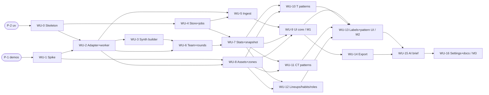

# CS2 Demo Scout — Delivery Plan (v1)

| Field | Value |
|---|---|
| Status | **Draft**, as of 2026-11-15. Reviewed once (§8). |
| Owner | Repository owner |
| Sources | [Product requirements](../product/requirements.md), [Target design](../architecture/target-design.md) (accepted 2026-11-15; ADR-002 and ADR-006 conditional on spike S-1), [Test strategy](test-strategy.md) |
| Repository state | No remote. |
| Progress | **WU-0 done** (2026-11-15): G-fast passes with 18 tests; both import-linter contracts kept and shown to fail on deliberate violations. **P-1 met:** 4 Mirage demos of the scouted team are in `tests/local_fixtures/demos/`. Scoreboards are no longer needed (see P-1). **P-2 met:** uv 0.13.8 installed. **WU-1 done** (2026-11-15): spike S-1 passed ([report](../../spikes/s1_report.md)). awpy pinned at 3.3.0. ADR-002 and ADR-006 accepted. **WU-2 done** (2026-11-15): canonical schema v1, awpy adapter and child-process worker. G-fast has 27 tests (T-04 crash, timeout, schema and sanity cases). G-demos has 8 (T-01 adapter part: the extract is clean and K/D/A equal the server counters on all 4 demos). The team-score half of T-01 waits for lineups in WU-6. **WU-3..WU-7 done** (2026-11-15). G-fast: 78 tests in about 2 min. G-demos: 13 tests in about 3 min. All pass. Highlights:
 • WU-3: synthetic matches written as demo files, so they pass through ingest and the parse child like real ones. Includes a call log for counting parses.
 • WU-4: SQLite library v1 (all designed tables, including `label` and `ai_brief`), atomic version swap, startup cleanup, job runner with one parse at a time and one job per entry.
 • WU-5: path import with per-file statuses. Upload import moves to WU-9 with the UI.
 • WU-6: lineups, roster proposal, buy classes and the complete-match rule.
 • WU-7: player-round features, findings v1 (`team.winrate`, `plr.stats`, `plr.openings`, `util.player`), heatmap grids, filtered views and the entries API. **T-01 passes in full on the 4 real demos:** final and half-time scores match the server; K/D/A are exact; ADR is within ±2.0, computed with our own damage capping.
 **Deviations recorded:** (1) Retained sources use gzip (`.dem.gz`, ratio 0.72), not zstd, which is missing from Python 3.13's standard library. (2) A demo's date is its file's modification time, because demos carry no match date. Downloads made in one batch get near-identical times. WU-9 must let the Analyst correct a demo's date. (3) Without a retained source, a parser upgrade keeps the older extract and flags `STALE_EXTRACT`, as design §7 says.
 **WU-8 done** (2026-11-15). P-5 approved by the owner.
 • `cs2scout assets fetch` installs awpy-data release 2000943: `images.zip` (2.9 MB) and `map_data.json`, each checked against a SHA-256 pinned in code. Only flat `*.png` radars are extracted. Radars for 16 maps, including lower levels for Nuke, Train and Vertigo.
 • Heatmap grids are binned in radar pixels when assets exist, and in world coordinates otherwise (DEP-2).
 • `ZoneProvider` + `PlaceNameZones`. The Mirage table maps only names whose meaning is certain. Unmapped places stay zones of their own (ADR-006).
 • T-16 passes on all 4 demos. A visual overlay of kills and plants on the Mirage radar lines up (owner-side G-manual check still open).
 G-fast: 84 tests in about 3 min (the pre-commit hook is getting slow). G-demos: 17 tests in about 8 min.
 **WU-9 done → M1 reached in tests** (2026-11-15). P-4 approved by the owner.
 • Vendored with SHA256SUMS: htmx 2.0.11 (0BSD) and Plotly.js 4.2.0 (MIT, chosen over the 5-day-old 4.3.0). Playwright 1.65.2 with headless Chromium for G-browser. Jinja2 and python-multipart are runtime dependencies.
 • Pages: library; new analysis (path import + file upload); live job progress with cancel; roster confirmation (proposed team first, opponents folded away, reuse an existing team); entry page with filters and Overview / Players / Demos tabs.
 • Overview: win rate by buy (chart + table). Heatmaps on the radar with a "most time spent" place table (C-3). Every "k/n" opens the round drawer. Players: stats, opening duels, utility, roster editing. Demos: match-date correction, lineup override, include/exclude.
 • The guard now also requires the token on every state-changing request outside /api. `cs2scout` opens the browser on start (`serve --no-browser` for tests).
 • Tried on the 4 real demos through the UI in a dev workspace: proposed the scouted team's name and its 5 core players, 91 rounds, stats and heatmaps render. Heatmap colours changed to yellow-orange-red, capped at the 95th percentile, after a visual check showed the first scale was too dark.
 Gates: G-fast 89 tests (~3 min), G-demos 17 (~5 min), G-browser 2 (~20 s). All pass.
 **M1 owner review (G-manual): passed** (2026-11-15). The owner ran the real app on their own demos: "everything looks good so far".
 **WU-10..12 done** (2026-11-15), committed and pushed per WU:
 • WU-10 T side: setups at 0:15/0:30/0:45, site hit (plant, else 3+ on site; otherwise "unresolved", never guessed), tempo, strategy clusters, buy-round tendencies, post-plants, fakes.
 • WU-11 CT side: positions at 0:20, setups, A/B stacks, early duels, rotations after enemy contact, retakes and saves.
 • WU-12: grenade lineups, opening-duel habits, weapon per buy, clutches, suggested roles shown with their metrics.
 • Patterns are mined once per version (`patterns.json`, stable keys) and recounted for every filter.
 • Tuned on the 4 real demos. Bugs fixed: round windows built per side (the last T round absorbed second-half plants); weapons looked up at the wrong tick. Retakes now also count a team death on the planted site's approach. Strategies and setups are compared by side of the map. BackAlley and House were mapped to B from evidence. **Q2 changed to 10% + 2 demos** (see requirements Q2).
 **WU-13 done → M2 reached in tests** (2026-11-15).
 • Labels: rename any pattern or override a suggested role (✎). Labels live in the library and are overlaid at view time. When new demos reshape a pattern, its label moves to the best-overlapping new pattern (Jaccard ≥ 0.5). Labels that match nothing are kept, unshown.
 • Player keys are now stable pseudonyms per SteamID, so roster edits never move labels or patterns to another player.
 • New tabs: T side (site and tempo with a histogram, strategies, setups, buy rounds, post-plants, fakes), CT side (stacks, setups, positions, rotations, early duels, retakes and saves), Utility (T and CT lineups on the radar). Players gains suggested roles with their evidence, plus habits. Weaker signals stay folded away.
 • Bug fixed: SQLite reuses a deleted entry's id, so the filtered-findings cache could show a new entry the deleted entry's results. The cache now keys on the findings file's identity.
 **M2 owner review (G-manual): passed** (2026-11-15). The owner reviewed the patterns on their own demos: "Looks right".
 **WU-14 done** (2026-11-15). The Export menu on the entry page downloads one self-contained HTML brief, with sections to choose and the current filters optional; the API also offers `POST /api/entries/{id}/export`.
 • The same section templates are rendered in static mode: no controls, support shown as plain k/n, and a gallery of team heatmaps instead of the picker.
 • Plotly, CSS and the radar image are inlined. Radars are embedded once and resolved by a small inline script. A strict CSP blocks all network access.
 • A leak guard refuses to write an export containing a SteamID or a local file path (`EXPORT_BLOCKED`).
 • The real 4-demo brief is 5.3 MB, and all 11 figures render offline.
 **WU-15 done** (2026-11-15). A new "AI brief" tab turns the filtered findings into an anti-strat brief with Claude, when `ANTHROPIC_API_KEY` is set (environment or `.env`). Without a key the tab explains how to turn it on, and nothing else changes.
 • Preview first: the tab shows the exact payload and instructions, a token estimate and the model. Nothing leaves the PC until "Send to Claude". The confirmation token is an HMAC of the payload hash, single-use, and expires in 10 minutes. Changing the filters or the analysis invalidates it.
 • The payload holds supported findings only (no round lists, coordinates, grids or SteamIDs), roster keys and nicknames, and demo dates and scores. The export leak guard also runs on it.
 • The call uses the official SDK: model `claude-opus-5-5` (change it with `CS2SCOUT_AI_MODEL`), streaming, effort `high`, structured JSON output, and the server-side refusal fallback.
 • Grounding: claims without citations, or citing unknown findings, are dropped. More than 20% dropped → `AI_UNGROUNDED`, and nothing is saved. Each kept claim shows its cited findings with k/n.
 • The brief is stored with its analysis version and is marked stale when the analysis changes. Only a brief that is not stale goes into the export, labelled "AI-generated".
 • SDK errors (bad key, rate limit, overload, network, refusal, truncation) → `AI_UPSTREAM` with a clear message. The entry is untouched.
 • Live check against the real API (P-3, G-manual) not run yet: it needs the owner's key.
 **WU-16 done** (2026-11-15). A Settings page (top bar) saves the Q1–Q3 thresholds, source retention, a workspace size limit (warning only) and the port in `<workspace>/settings.json`. It also shows disk use per area and free space; the library page shows a one-line summary.
 • Every recompute uses the saved thresholds. Each version records the thresholds it was built with (`config.json`), so filtered views recount with the same ones. An analysis built with other thresholds offers "Update now".
 • Retention applies to new imports. The saved port is used at the next start, and `CS2SCOUT_PORT` still wins.
 • The README covers install, run, use, settings, the AI brief, privacy, backup, and sharing exports.
 • **P-6 recorded:** the awpy code is MIT. Neither the awpy README nor its documentation states terms for the radar images, which are derived from CS2 game files (checked 2026-11-15). Whether to share them is the owner's call. The Export menu now has **include map images**: unticked, figures render on a blank map, so an export can always be shared without them.
 • Known gap, not in v1 scope: deleting an analysis leaves its parsed data and retained demo copies in place. There is no cleanup command; the README says so.
 **Brief rework after owner feedback** (2026-11-16). The owner asked for tendencies instead of statistics, the in-game round timer, pistol rounds on their own, lurker paths, opening-duel spots, rounds to watch, a download, and a cost check. The owner approved sending per-round summaries (FR-AI-2 changed). Built: round stories, round-timer times everywhere, new brief sections and instructions (`ai/instructions.md`), round citations with `demo_gototick`, Markdown download, and token usage and cost per brief. On the real 4 demos the payload is about 40k input tokens.
 **M3: waiting on the owner.** All automated gates pass. The owner's J1–J5 run-through on their own demos is still to do; J5 needs their API key (P-3).|
| Outcome | The owner can import N demos of one team on one map. They can explore team and player patterns with support counts, and export a brief for teammates. The AI summary is optional. |

**What this plan covers:**
- local implementation and verification only.
- **No release or deployment exists.** The app runs from the repository on the owner's PC.
- Commits happen per work unit (WU), after the owner says OK.
- Publishing to a remote is out of scope until the owner asks.

## 1. Prerequisites (owner actions)

| ID | What | Needed by | Blocks |
|---|---|---|---|
| **P-1** | **3–5 demos of one team on one map**, in `tests/local_fixtures/demos/` (gitignored). **Changed 2026-11-15:** match-page scoreboards are no longer needed. The accuracy reference is the game server's own scoreboard counters inside each demo (test strategy §1). Owner scoreboards are only a last-resort fallback if S-1 cannot read those counters. | WU-1 | The critical path |
| P-1b | *Optional:* 1 demo on the same map without that team. It gives a real-data check of `TEAM_NOT_FOUND`. | WU-6 | Nothing. Synthetic data covers the logic. |
| **P-2** | Install `uv` once: `winget install astral-sh.uv`, or `py -3.13 -m pip install --user uv`. It is not installed now (checked 2026-11-15). | WU-0 | WU-0. WU-1 can use a plain venv instead. |
| P-3 | *Optional:* an Anthropic API key in `.env` | WU-15, live check only | Nothing. Tests use a fake transport. |
| P-4 | Approve the Playwright + Chromium dev download (~150 MB) | WU-9 | The G-browser gate |
| P-5 | Approve the one-time awpy-data asset download: radar images, map transforms and nav files, pinned and checksummed | WU-8 | Radar visuals |
| P-6 | Check the licence of the awpy-data radar images before sharing any export (U-6) | First shared export | Sharing only |

## 2. Work units

Sizes are relative: S < M < L. They are not time promises.

**Completion rule.** A WU is complete only when:
- its evidence passes in the named gates, **and**
- the integration check passes.

A WU that only runs locally is not complete.

| WU | Outcome (observable) | Requirements | Depends on | Evidence → gate | Size |
|---|---|---|---|---|---|
| **WU-0** Skeleton and guardrails | `uv run cs2scout` serves `/api/health` on `127.0.0.1` only. Foreign Host or Origin, or a missing token, gets a 403. The workspace folder is created. Package layout as in design §4. ruff, pytest markers (`demos`, `browser`), and import-linter contracts. | C-1, DRV-5, AT-8, AT-11 | P-2 | AT-8, AT-11 → G-fast | S |
| **WU-1** Spike S-1 | `spikes/s1_report.md` records, with no SteamIDs: player count, event coverage, whether `place` is available and how fine-grained it is, peak memory, extract size, parse time. It also confirms that the server's scoreboard counters (per-player K/D/A/damage, team scores) can be read from the demo, and compares them with stats computed from events. If awpy cannot read the counters, the report chooses a test-only demoparser2 reader instead. awpy version pinned. Standalone records for ADR-002 and ADR-006 written. | U-1, U-2, A1, A2, ADR-002/006 | P-1 | Report reviewed by the owner → G-manual | S–M |
| **WU-2** Canonical schema + awpy adapter + parse worker | `core/schema.py` v1. The adapter produces every table in design §5.2. Extraction runs in a child process with a timeout and a kill. Sanity checks and a `warnings` list. Parquet output via `_partial` → rename. | DEP-1, DEP-3, DRV-1, DRV-3, FR-IN-2 | WU-0, WU-1 | T-01, T-04 (crash/timeout part) → G-demos, G-fast | M |
| **WU-3** Synthetic match builder (test support) | `tests/support/synth.py` builds canonical tables from a small scenario description: rosters, sides, overtime, buys, positions per checkpoint, grenades, plants. `FakeParserAdapter` plugs into the worker. Committed, with no real player data. | Enables T-02, T-05..T-12 | WU-2 (schema only) | Used by the tests of WU-6..13. No test of its own beyond those (see test strategy, exclusions). | M |
| **WU-4** Store, library, jobs | SQLite schema v1, workspace layout, entry versions with atomic pointer swap, startup cleanup (`building` versions, tmp). Job runner: single parse slot, per-entry lock (`CONFLICT_JOB_RUNNING`), progress, cancel. Garbage collection with confirmation. | FR-LIB-1..4, DRV-9, J1 cancel | WU-0 | T-06, T-07 → G-fast | M |
| **WU-5** Ingest + import API | Path import and upload. Bounded, name-agnostic decompression. sha256 and match_key duplicate checks. Header probe (`NOT_CS2`, `MAP_MISMATCH`). Incomplete-match flag. Retained `source.dem.gz`. Per-file statuses returned. | FR-IN-1..5, DRV-10, DRV-11, ADR-003 | WU-2, WU-4 | T-04, T-08 → G-fast. T-01 import path → G-demos. | M |
| **WU-6** Team resolution + round classification | Core roster, stand-ins, nickname merge, `TEAM_NOT_FOUND`, side labels through half-time and overtime. Buy class with configurable thresholds (`AnalysisConfig`). Opponent buy, outcome and end reason. Warmup and knife rounds excluded. Overtime labelled. | FR-TEAM-1,3,4,5, FR-RND-1..3, FR-IN-6, Q1 | WU-2, WU-3 | T-02, T-03 → G-fast. T-01 sides → G-demos. | M |
| **WU-7** Stats, grids, Findings Snapshot v1 | Snapshot schema v1 (design §5.4) with `round_refs` and support. Per-player stats, openings, flash effectiveness, utility counts per round type, heatmap grids per subject, side and phase. S7 filter recount, minimum support, low-sample flag, recency. | FR-PLR-2,3,5, FR-UTIL-1,3,4 (counts), FR-CONF-1..4, I-1, I-2 | WU-4, WU-6 | T-01 stats, T-05, T-09 → G-fast + G-demos | M |
| **WU-8** Map assets + zones | `cs2scout assets fetch` downloads the pinned awpy-data version once and verifies its checksums (P-5). It also includes the world-to-radar transform, including lower levels. `ZoneProvider` + `PlaceNameZones`, with a place → site/lane table for each Active Duty map. If S-1 rejected place names, it uses `PolygonZones` instead and grows to size L. "Stats only" fallback for maps without assets. | DEP-2, DRV-7, ADR-006, Q4 | WU-1, WU-2 | T-16 → G-demos. Radar alignment → G-manual. | S–M (L if polygons) |
| **WU-9** Web UI core → **M1** | Library page. New-analysis wizard: path import, progress, cancel, list of rejected files with reasons, roster confirm and edit, option to reuse an existing team (FR-LIB-5). Overview, Players and Demos tabs: include or exclude a demo, assign the team. Filters, round-list drawer, delete with typed confirmation. Radar heatmaps. A table next to every chart. No-assets fallback. htmx sends the launch token. `cs2scout` opens the browser on start (WU-0 only prints the URL, because there are no pages yet). | J1, J2, J3, FR-TEAM-2/3, FR-LIB-1..5, FR-CONF-3, C-3, DEP-2 | WU-5, WU-7, WU-8, P-4 | T-17 → G-browser. M1 review → G-manual. | L |
| **WU-10** T-side patterns | Default setups at the checkpoints, site hit and hit time ("unresolved" when unclear, never guessed), tempo bands, strategy clusters with "unique" leftovers, pistol/eco/force behaviour, post-plant setups, fakes. Utility composition for each strategy. | FR-TS-1..6, FR-UTIL-4, Q3 | WU-7, WU-8 | T-10, T-05 → G-fast. M2 review → G-manual. | M–L |
| **WU-11** CT-side patterns | Position distributions, setup signatures, aggression and info plays, rotation times, retake vs save. Utility for each setup. | FR-CT-1..5, FR-UTIL-4 | WU-7, WU-8 | T-10, T-05 → G-fast | M |
| **WU-12** Lineups, habits, roles | DBSCAN lineups per grenade type, habits filtered by support, rule-based roles shown with their metrics. | FR-UTIL-2, FR-PLR-1, FR-PLR-4 | WU-7, WU-8 | T-10, T-05 → G-fast | M |
| **WU-13** Pattern identity, labels, pattern UI → **M2** | Stable keys and Jaccard label carry-over, orphaned labels kept. Label API, role override. T, CT and Utility tabs. | FR-TS-3 (rename), FR-PLR-1 (override), ADR-004 | WU-9..12 | T-11 → G-fast. T-17 extended → G-browser. M2 review → G-manual. | M |
| **WU-14** Export | Static render mode, inliner, CSP, section picker. SteamIDs and paths removed. Counts identical to the app. | FR-EXP-1, FR-EXP-2, DRV-6, C-2 | WU-9. Sections extended after WU-13. | T-13 → G-browser | M |
| **WU-15** AI brief | Payload builder and preview, token bound to the payload hash, Anthropic SDK client (the model ID comes from config, and current Claude docs are re-read at implementation time). Grounding validator, stale marking, inclusion in the export with the "AI-generated" label. | FR-AI-1..4, FR-EXP-3, DRV-12 | WU-7, WU-13, WU-14 | T-14, T-15 → G-fast. Optional live call → G-manual (P-3). | M |
| **WU-16** Settings, docs, final journey → **M3** | Settings: thresholds Q1–Q3, source retention, workspace cap, port. Disk usage shown. README: install, run, backup, privacy. P-6 licence check recorded. Every gate passes on a clean workspace. J1–J5 completed by hand on the owner's demos. | Q1–Q3, ADR-003 setting, C-4, DRV-17 | All | All gates + G-manual | S–M |

### Requirement coverage

Every FR, DEP and C ID in the product requirements maps to at least one WU above. These are split across WUs:

| Requirement | Covered by |
|---|---|
| FR-UTIL-4 | WU-7 (counts) + WU-10/11 (utility per strategy and setup) |
| FR-EXP-3 | WU-15 (it needs the brief) |
| FR-LIB-5 | WU-4 (shared `team` table) + WU-9 (reuse a team in the wizard) |

## 3. Dependency graph and sequencing

**Critical path:** P-1 → WU-1 → WU-2 → WU-3 → WU-6 → WU-7 → WU-10 → WU-13 → WU-15 → WU-16.

**Work that can start while waiting for P-1:** WU-0 and WU-4. Neither needs awpy or real demos.

**Can run in parallel** (independent modules, no shared mutable output):
- WU-4 ∥ WU-2/WU-3.
- WU-8 ∥ WU-6/WU-7.
- WU-10 ∥ WU-11 ∥ WU-12. Each owns its own `core/patterns_*.py` and `core/features_*.py` module. Shared helpers go into `core/features.py` only in WU-7.
- WU-14 ∥ WU-10..12. The final parity check runs after WU-13.

Parallel work is optional. One implementer can do it all in order.

### Integration checks between units

| After | Check |
|---|---|
| WU-5 + WU-7 | API journey: import P-1 demos → confirm roster → `GET /findings` returns stats equal to the server's scoreboard counters in each demo (T-01 end to end) |
| WU-9 | Browser journey J1→J3 on the P-1 demos (T-17) |
| WU-13 | J2 journey: rename a strategy, add a demo, the label survives (T-11 end to end) |
| WU-14 | Export from the J3 state. Counts equal the API (T-13). |
| WU-16 | J1–J5 by hand + all gates on a fresh workspace |

## 4. Milestones

| Milestone | Exit criteria |
|---|---|
| **M1: useful stats tool** (after WU-9) | The owner imports their own demos. Roster, stats, openings, flash and utility counts, and heatmaps are correct and readable. Heatmaps line up with the radar. G-fast, G-demos and G-browser pass. |
| **M2: scouting patterns** (after WU-13) | On the P-1 team, the owner judges each top-5 pattern per tab as plausible, wrong or unclear. M2 is reached when no pattern is "wrong" without an explanation. Thresholds can be tuned through `AnalysisConfig` without a re-parse. |
| **M3: v1 complete** (after WU-16) | All FRs covered. All gates pass. Export shared once after P-6. |

## 5. Recovery and irreversible steps

- **Workspace data is the owner's.**
  - Garbage collection and entry delete are the only destructive actions, and both ask for confirmation (FR-LIB-2).
  - Tests run in a temp workspace (`CS2SCOUT_HOME`) and never touch the real one.
- **SQLite schema v1 only.**
  - The first later schema change brings a forward-only migration, run on startup.
  - Before migrating, the app makes an automatic copy of `library.sqlite`.
  - Rollback means restoring that copy. There is no downgrade path, only roll-forward.
- **Dependency rollback:** revert `uv.lock`. Extracts are versioned per parser and schema, so older versions stay readable (design §7).
- **No release or deployment.** "Done" means the M3 criteria. Proving product impact (requirements §7) is a separate step after real match prep.

## 6. What would invalidate parts of this plan

| Change | Affected |
|---|---|
| S-1 fails QS-1 with awpy | WU-2 switches to a demoparser2 adapter. The schema and everything downstream stay the same. ADR-002 reopens. |
| S-1 shows `place` is unusable | WU-8 grows to L (polygons per map). WU-10..12 keep the same port. |
| D5 reversed (speed matters) | WU-4 adds a process pool (ADR-005) |
| Q6 accepted (2D replay) | New WU after M2, as a JS island (ADR-001) |
| Owner wants teammates on the live app | Out of scope for this plan. It reopens DRV-5 and DRV-18. |

## 7. Unresolved choices left to implementation (bounded)

- The CSS approach and the Plotly.js bundle (ADR-001 leaves these open).
- The exact distance thresholds for clustering. They live in `AnalysisConfig`, start from the defaults, and are tuned at M2.
- ~~The ADR tolerance.~~ **Resolved by S-1:** ±2.0 ADR. The server's damage formula matches no event-based definition exactly, and awpy's ADR stays within 1.75 of it for 40/40 players. K/D/A and scores are compared exactly.

## 8. Review record (2026-11-15)

The plan was reviewed with the `ln-33-plan-reviewer` checklist as a self-review pass, so independence is reduced. Findings and the corrections applied above:

| # | Severity | Finding | Correction |
|---|---|---|---|
| 1 | MAJOR | awpy-data downloads assets automatically on first use. That is a second outbound connection, which conflicts with DRV-5 ("only outbound = Claude API"). | WU-8 makes it an explicit, pinned, checksummed `assets fetch` (P-5). The design and baseline were updated to list it. |
| 2 | MAJOR | Without synthetic data, team, overtime, stand-in, pattern and label tests would depend on real demos that cannot be committed. | WU-3 adds the synthetic match builder and `FakeParserAdapter` |
| 3 | MAJOR | Tests that need real demos could skip silently, so a missing fixture would look like a pass | G-demos fails when the fixtures are missing (test strategy §3) |
| 4 | MAJOR | FACEIT/ESEA ADR may use a different formula, which would make T-01 fail for no real reason | Exact checks only for K/D/A, scores and sides. The ADR tolerance comes from S-1 (§7). |
| 5 | MAJOR | WU-10..12 were marked parallel but shared `features.py` | Each WU owns its own module (§3) |
| 6 | MINOR | The spike was made to depend on the skeleton for no reason | WU-1 depends only on P-1 |

**Later change (2026-11-15, owner question).** The T-01 reference moved from owner-supplied FACEIT scoreboards to the server's scoreboard counters recorded in each demo. Finding 4 still stands: it now concerns the server's damage counter versus our ADR formula.

**Verdict after the corrections: `CONCERNS`.** The plan is executable. These risks are accepted:
- Pattern quality has no automated oracle. It relies on the M2 owner review.
- The critical path waits on P-1.
- awpy 3.3.0 was released on 2026-11-12. That risk is covered by pinning the version in WU-1.
