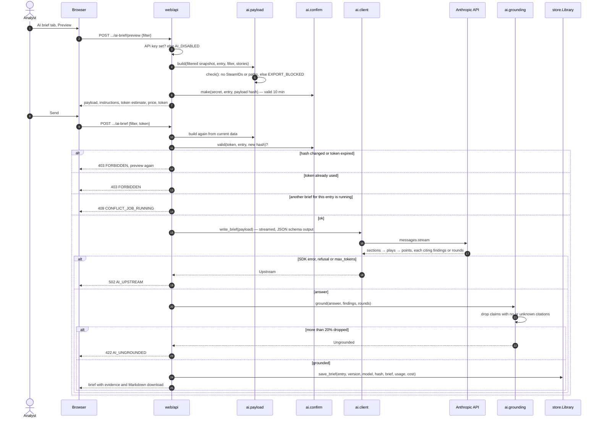
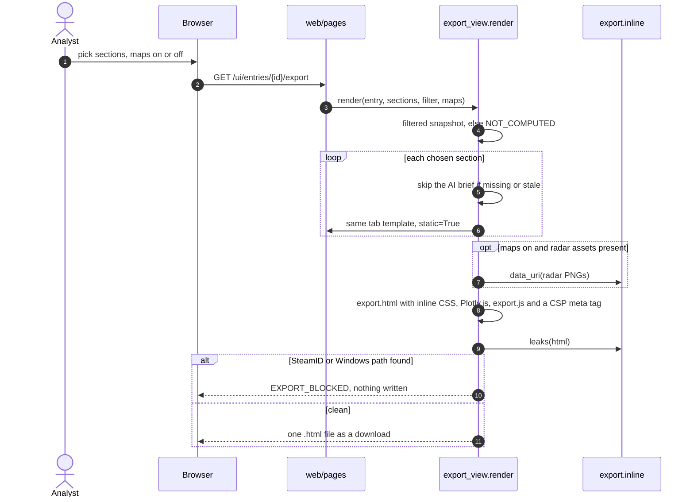

# AI brief and export

The two ways a scouting result leaves the app. Both start from the same filtered snapshot
(see [Analysis](analysis.md#filtered-views-s7)). Both block SteamIDs and file paths.

## AI brief

Code: `web/api.py` (`preview_brief`, `create_brief`), `ai/payload.py`, `ai/confirm.py`,
`ai/client.py`, `ai/grounding.py`, `ai/instructions.md`. Design: target design §6.5.

Nothing is sent before the Analyst has seen the exact payload. The confirm token is bound to
the payload's hash, so a changed filter or a new version needs a new preview.

What the payload holds, and what it does not:

| Sent | Never sent |
|---|---|
| Findings that pass support: id, kind, title, params, k of n, outcome, recency | `round_refs`, grids, `land`/`throw`/`hit_times_s` params |
| Roster: player key and nickname | SteamIDs |
| One story per round, times on the round timer | Raw demos, file paths |
| Demo labels and dates, the active filter, the callout glossary | The API key |

## Export

Code: `web/export_view.py` (`render`), `export/inline.py`, `templates/export.html`.
Design: target design §6.4.

The CSP is `default-src 'none'` with inline scripts and styles and `data:` images. The file
cannot make a network request when someone opens it.
