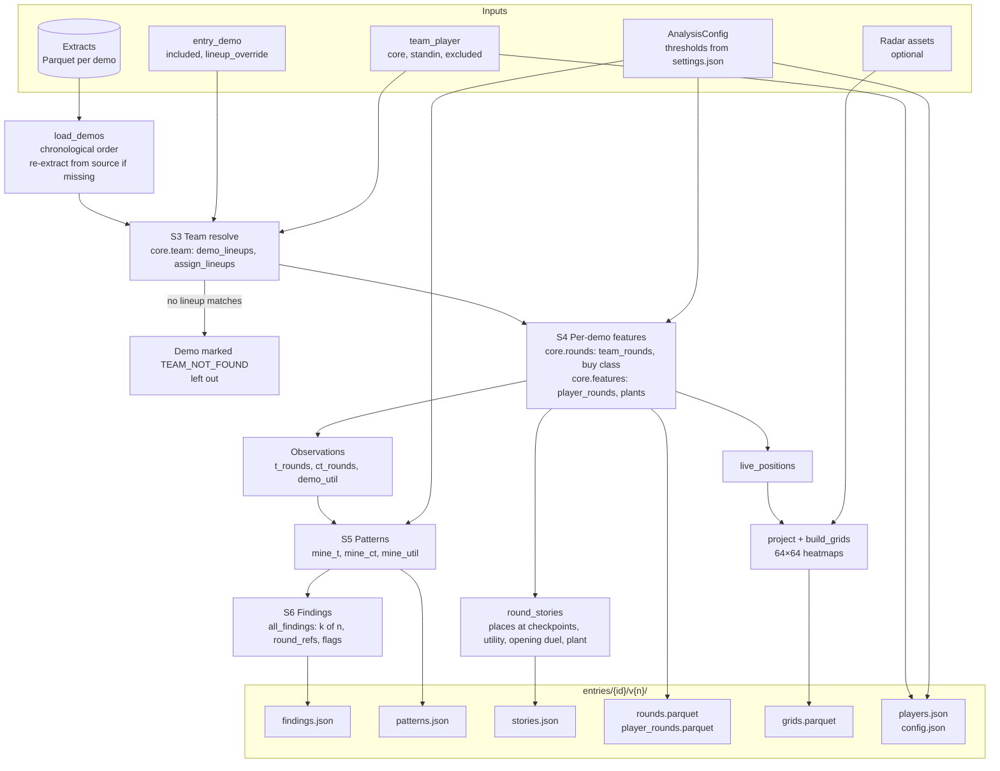
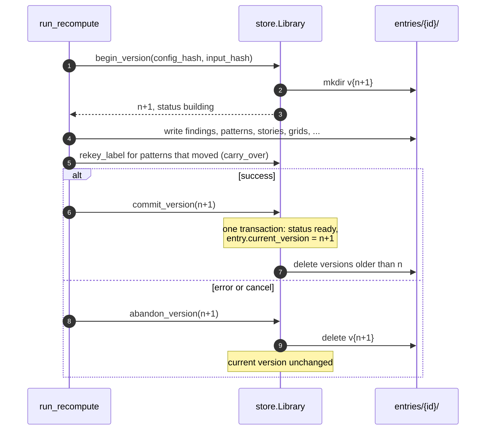
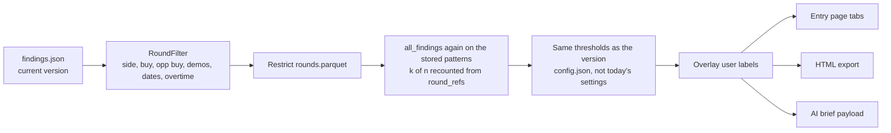

# Analysis

How cached extracts become a version with findings, round stories and heatmaps. Code:
`jobs/analysis.py` (`run_recompute`, `_analyse`), `core/*`, `web/findings_view.py`.
Design: target design §5.3 and §6.2–6.3.

## What starts a recompute

Each of these submits a recompute job for the entry. Only one job per entry runs at a time.

- J1: the Analyst confirms the roster (`POST /api/entries`).
- J2: new demos are accepted (`POST /api/entries/{id}/demos`; import and recompute in one job).
- A demo is included, excluded, given a lineup or a date (`PATCH .../demos/{sha}`).
- The roster changes (`PUT .../roster`).
- "Update now" (`POST .../recompute`), shown when the version is older than
  `core.findings.SCHEMA_VERSION` or was built with other thresholds.

## Data flow

Recompute never parses a demo it already has an extract for. Patterns are mined once, on all
included demos. Filters later only recount them.

## Atomic version swap

A version is written to a new folder while its row says `building`. Only one transaction makes
it current. A failed or cancelled job leaves the current version as it was.

## Filtered views (S7)

Pages, the export and the AI brief all read a filtered view of the same snapshot.

Results are cached in memory per version and filter (`findings_view.filtered_snapshot`).
Because patterns are mined on the full set, a pattern keeps its id and its label under any
filter. The trade-off: a pattern that exists only inside a filtered subset is not found.
