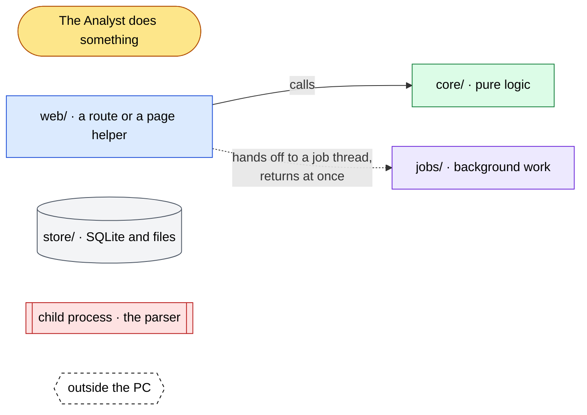
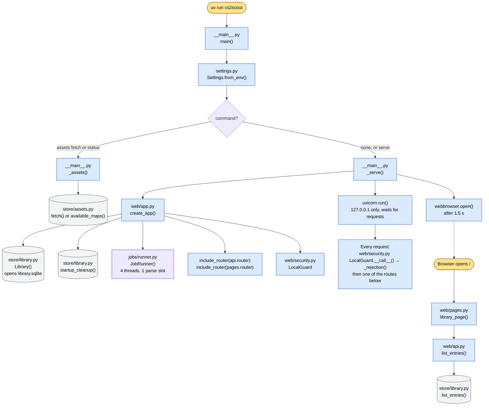
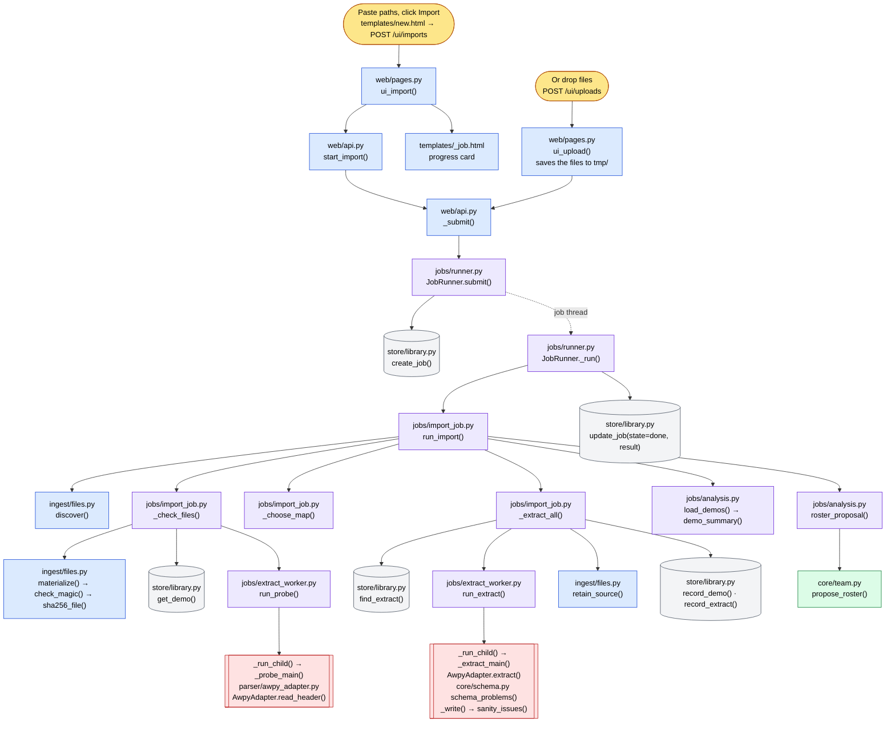
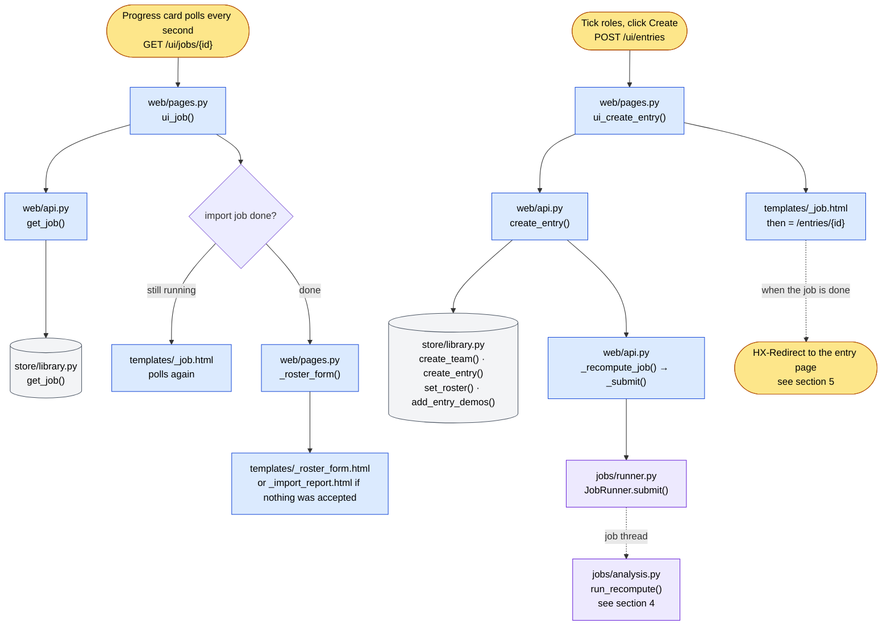
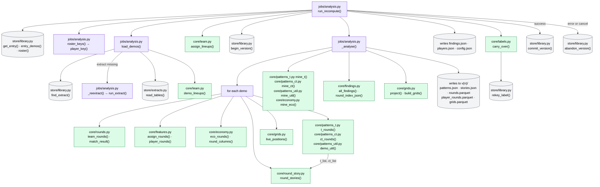
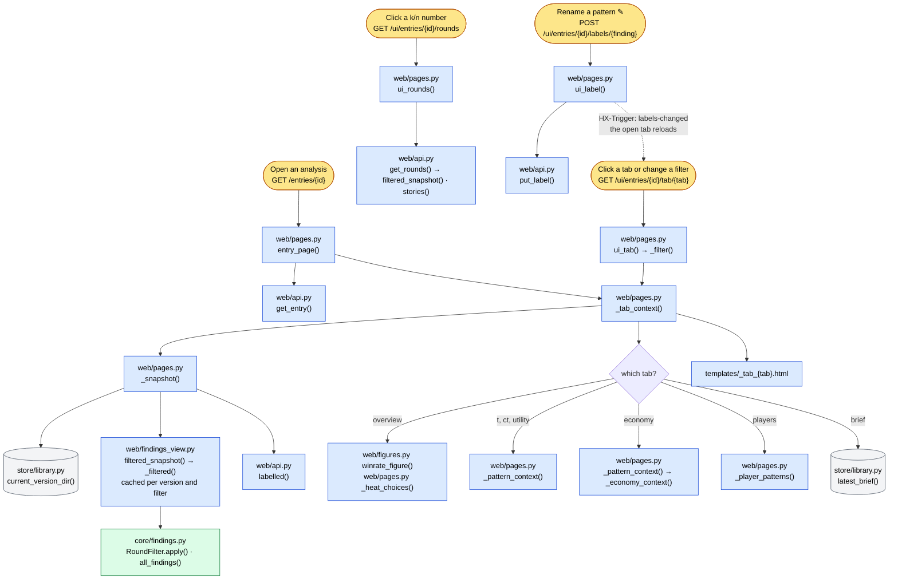
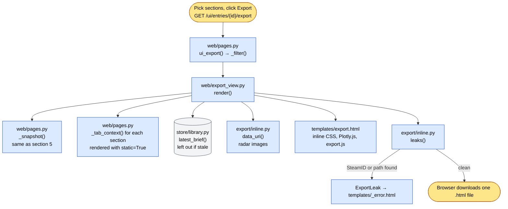
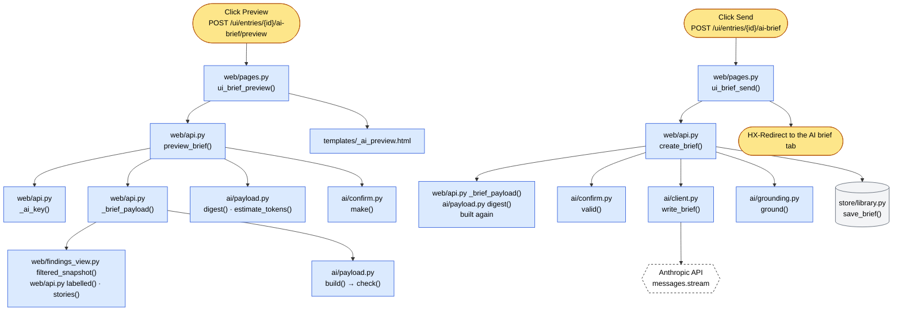

# Call graph

Which function calls which, from starting the app to each button the Analyst clicks. Every
box is a file and a function. Read top to bottom.

Use this page when you want to change something: find the button, then follow the arrows to
the function that does the work. The other pages explain *why* each step exists. This one only
says *where* it is.

## How to read the boxes

- Paths are under `src/cs2scout/`.
- `ingest/`, `export/` and `ai/` are drawn blue like `web/`. They run in the server process,
  in the request thread, and are not pure.
- Small helpers (logging, error wrapping, `_page()` for most routes) are left out.

## 1. Start the app

`uv run cs2scout` finds `main()` through `[project.scripts]` in `pyproject.toml`.

## 2. Click "Import" on the New analysis page

The route returns at once with a progress card. The work happens in a job thread.

## 3. Progress, then "Create analysis"

Other buttons that end in the same `_recompute_job()`:

- "Update now": `pages.ui_recompute()` → `api.recompute()`.
- The Demos tab: `pages.ui_change_demo()` → `api.change_demo()`.
- The roster: `pages.ui_roster()` → `api.put_roster()`.
- "Add demos" runs `run_import()` and then `run_recompute()` in one job (`api.add_demos()`).

## 4. Inside a recompute

## 5. Open an analysis, switch tab, change a filter

## 6. Click "Export"

## 7. AI brief: "Preview", then "Send"

