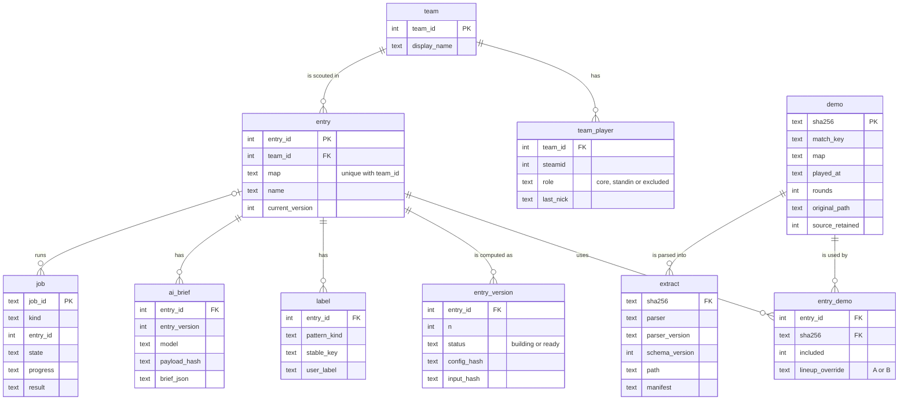
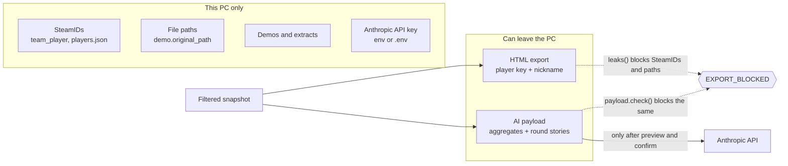

# Data model

Where the app keeps its data, and which data may leave the PC. Code: `store/library.py`
(SQLite schema), `store/extracts.py`, `store/prefs.py`. Design: target design §5.1.

## SQLite tables

`library.sqlite` holds metadata only. The heavy data is in Parquet and JSON files.



- A team is shared across maps. Its roster is shared too.
- A demo is shared across entries. It is parsed once per parser version.
- `label` uses the pattern's stable key, so a rename survives a recompute.

## Workspace folder

The root is `%LOCALAPPDATA%\CS2DemoScout\`, or `CS2SCOUT_HOME`.

```text
library.sqlite                         metadata (above)
settings.json                          thresholds, retain_sources, workspace cap, port
demos/{sha}/source.dem.gz              retained source, used to re-extract after upgrades
extracts/{sha}/{parser}@{ver}+s{schema}/
    *.parquet, manifest.json           one immutable extract per demo and parser version
entries/{id}/v{n}/
    findings.json                      the Findings Snapshot
    patterns.json                      mined patterns with stable keys
    stories.json                       one story per round (local only)
    rounds.parquet, player_rounds.parquet
    grids.parquet                      heatmap values
    players.json                       player key to SteamID (local only)
    config.json                        thresholds this version used
assets/awpy-data/{release}/            radar images and map data, from `cs2scout assets fetch`
tmp/                                   decompressed demos while importing, cleared on start
```

## What may leave the PC



A player's key (`p` plus 6 hex characters) is a hash of the SteamID. It is stable across
roster edits, so labels and per-player findings never move to another player.
