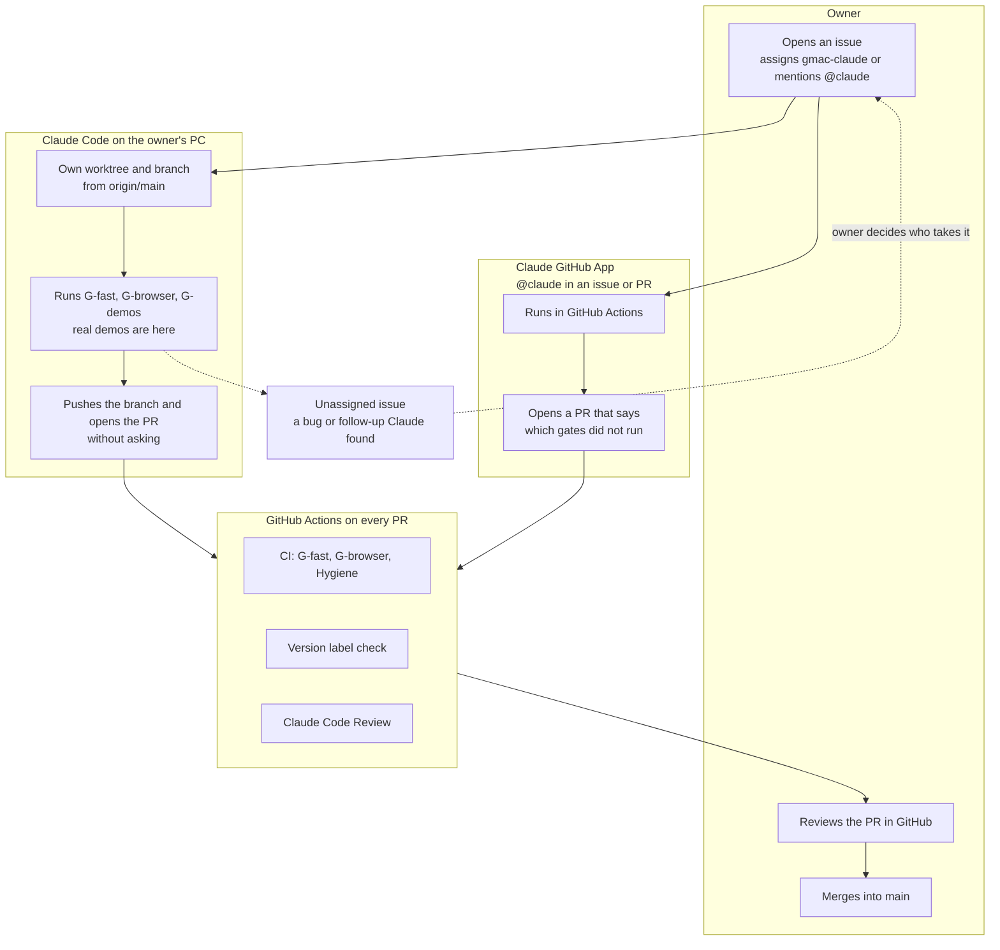
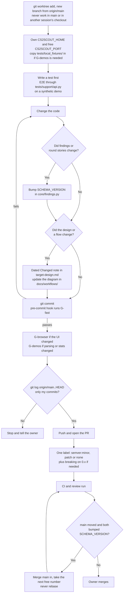
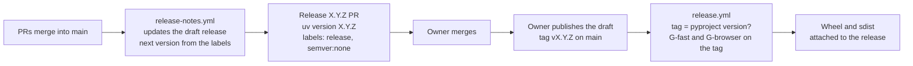

# Development workflow

How a change goes from an idea to `main`, and from `main` to a release. The rules are in
[CLAUDE.md](../../CLAUDE.md). The gates are in the [test strategy](../delivery/test-strategy.md).
Labels and releases are in [versioning](../delivery/versioning.md).

## Who does what

Only the owner merges. Claude may open issues but never assigns them.

Claude does not comment on issues or PRs unless asked.

## One change, step by step

Every PR follows the template: what changed, the issue it closes, a **Try it** section that
walks the owner through the change in the app, which gates ran and what was not tested.

## The gates

| Gate | What it runs | On the owner's PC | In GitHub Actions |
|---|---|---|---|
| G-fast | `ruff format --check`, `ruff check`, `lint-imports`, `pytest` | Pre-commit hook | Every PR and push to `main`, on Windows |
| G-browser | `pytest -m browser` | By hand, after `playwright install chromium` | Every PR and push to `main`, on Ubuntu |
| G-demos | `pytest -m demos --require-demos` | By hand, with real demos | Never. Demos contain SteamIDs. |
| Hygiene | `.github/scripts/hygiene.sh` | — | Every PR. Fails on demos, archives, local fixtures or a real-looking SteamID. |
| Version label | `pr-labels.yml` | — | Every PR. Fails until there is exactly one `semver:*` label. |

## Release

## Before you commit

- No real team names, nicknames or SteamIDs anywhere. Tests use `a1`–`a5` and `opp`.
- No demos and nothing from `tests/local_fixtures/`.
- No API key in code, logs or output. Tests use the fake Claude transport.
- `core` imports nothing else from `cs2scout`. Only `parser` imports awpy. `lint-imports`
  checks both.
- Keep edits to shared files small (`core/findings.py`, `docs/`). Branches collide there.
- On Windows, a running `cs2scout.exe` locks the virtual environment. Use `uv run --no-sync`
  and commit with `UV_NO_SYNC=1`.
