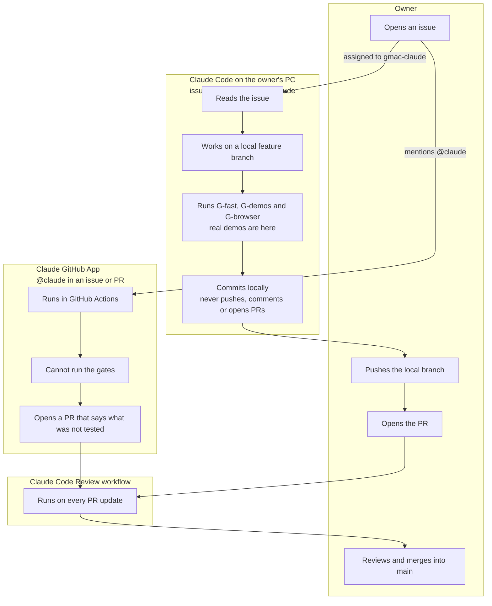
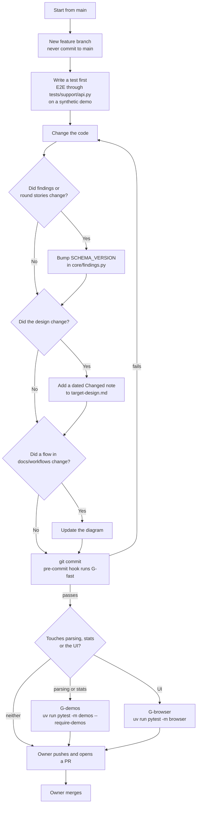

# Development workflow

How a change goes from an idea to `main`. The rules are in [CLAUDE.md](../../CLAUDE.md). The
gates and test IDs are in the [test strategy](../delivery/test-strategy.md).

## Who does what

Three people or agents can work on the code. Only the owner pushes to GitHub and merges.

## One change, step by step

## The gates

| Gate | What it runs | Where it can run |
|---|---|---|
| G-fast | `ruff format --check`, `ruff check`, `lint-imports`, `pytest -n 8` | Every clone. The pre-commit hook runs it. |
| G-demos | `pytest -m demos --require-demos` | Only the owner's PC. It needs real demos in `tests/local_fixtures/demos/`. |
| G-browser | `pytest -m browser` | Any clone after `uv run playwright install chromium`. |

## Before you commit

- No real team names, nicknames or SteamIDs anywhere. Tests use `a1`–`a5` and `opp`.
- No demos and nothing from `tests/local_fixtures/`.
- No API key in code, logs or output. Tests use the fake Claude transport.
- `core` imports nothing else from `cs2scout`. Only `parser` imports awpy. `lint-imports`
  checks both.
- On Windows, a running `cs2scout.exe` locks the virtual environment. Use `uv run --no-sync`
  and commit with `UV_NO_SYNC=1`.
