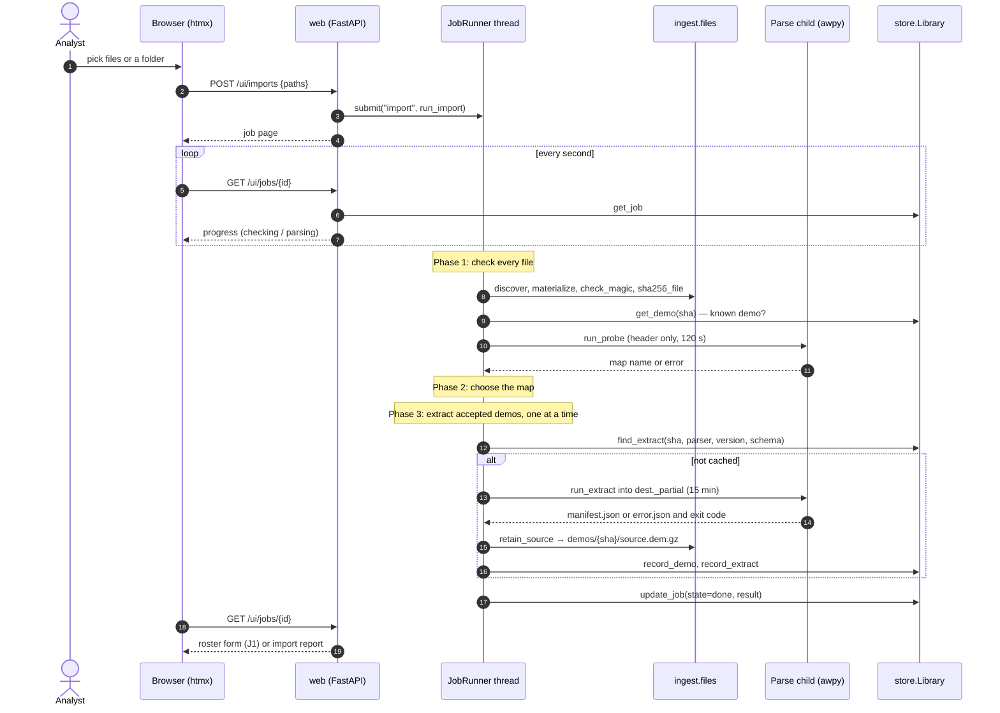
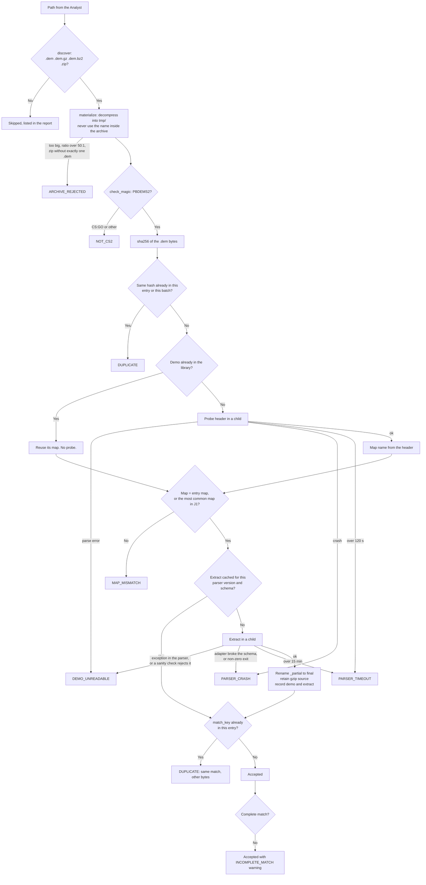

# Import

How demo files become cached extracts. Code: `jobs/import_job.py`, `ingest/files.py`,
`jobs/extract_worker.py`, `parser/awpy_adapter.py`. Design: target design §6.1.

## Who talks to whom

The parser always runs in a spawned child process. A crash or hang in the parser can never
take the server down. One parse runs at a time across the app (`parse_slot`).

## What happens to each file

Each file ends with one status: `accepted`, `rejected` (with a code) or `duplicate`.
A rejected file never stops the others.

## Cancel and crash

- **Cancel:** the job sets its cancel flag. The runner kills the parse child at once and deletes
  its `_partial` folder. Extracts that already finished stay cached. No entry is created.
- **Server crash:** on the next start, `Library.startup_cleanup` deletes `_partial` folders and
  `tmp/cs2scout-*` files and marks running jobs as failed. See [Runtime](runtime.md).
- **Temp files:** every decompressed `.dem` in `tmp/` is deleted when the job ends, success or
  not.

## Parser upgrades

An extract is keyed by `(sha256, parser, parser_version, schema_version)`. After a parser or
schema upgrade, the old extracts no longer match. Two things rebuild them:

- Importing the demo file again parses it with the current parser.
- A recompute rebuilds a missing extract from the retained source. Without a source it uses
  the older extract and reports `STALE_EXTRACT`. See [Analysis](analysis.md).
