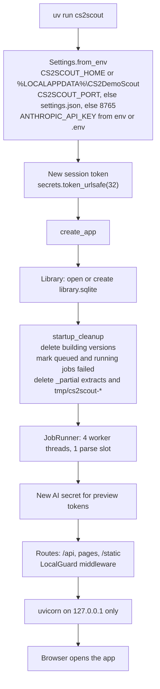
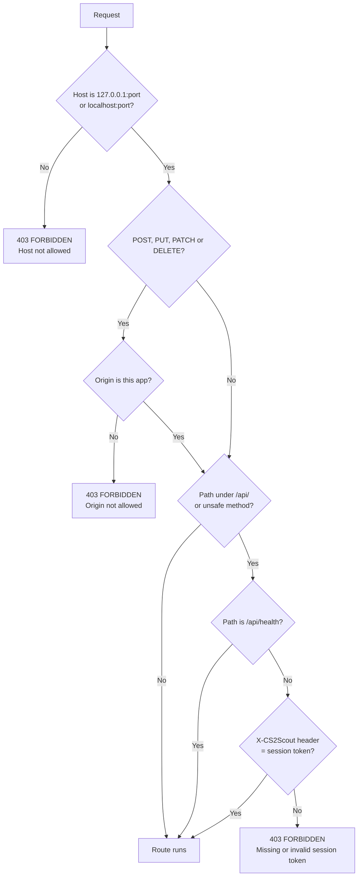
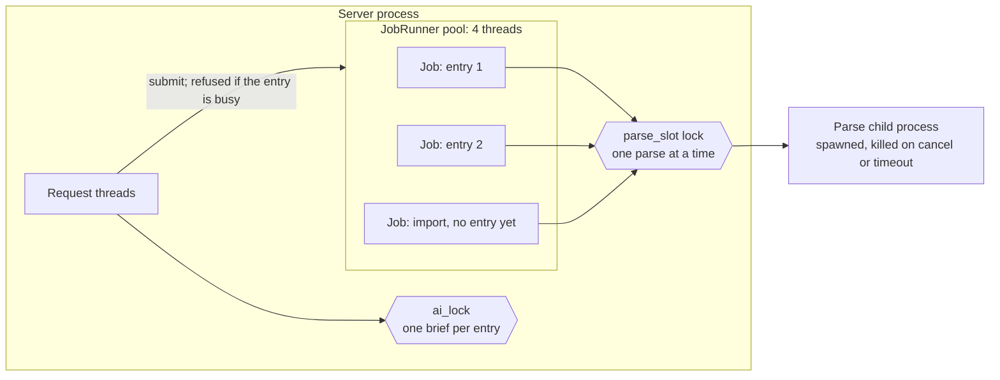

# Runtime

How the app starts, which requests it lets in, and how background work shares the machine.
Code: `__main__.py`, `settings.py`, `web/app.py`, `web/security.py`, `jobs/runner.py`.

## Startup

A restart makes every open AI preview invalid, because the AI secret is new.

## Request guard

Every HTTP request passes `LocalGuard` before it reaches a route. It stops other machines,
DNS rebinding and other web pages from driving the app.

Pages get the token in a meta tag. htmx sends it on every request. Websockets are closed.
The OpenAPI docs are turned off.

## Concurrency

- One job per entry at a time. A second one gets `CONFLICT_JOB_RUNNING`.
- Jobs for different entries run side by side. They wait for each other only at the parse
  slot.
- Analysis work (Polars) runs in the job thread, not in the child.
- An AI brief runs in the request thread, not as a job. `ai_busy` stops a second brief for the
  same entry.
- On shutdown the runner sets every cancel flag and waits for the threads.
