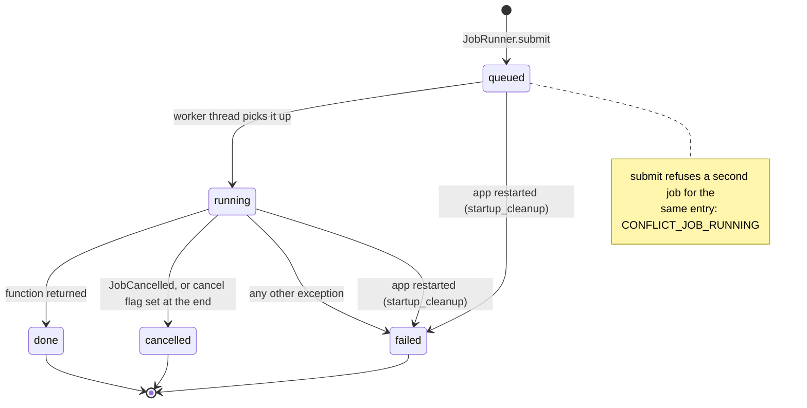
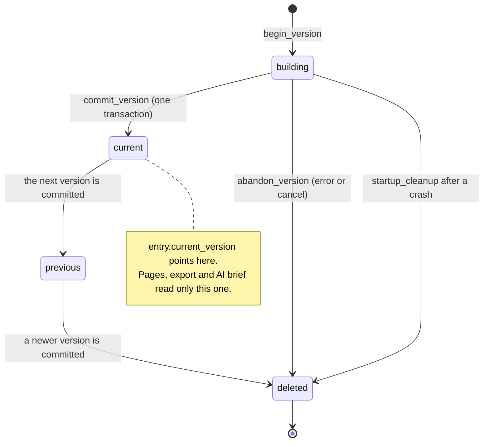
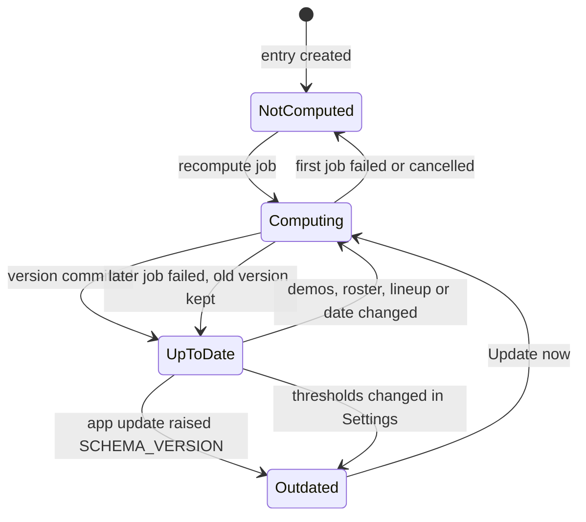
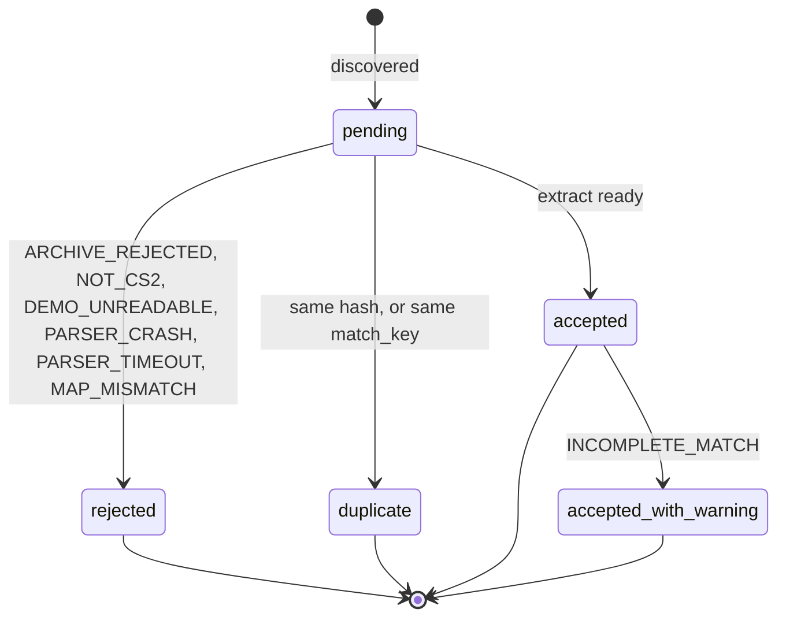
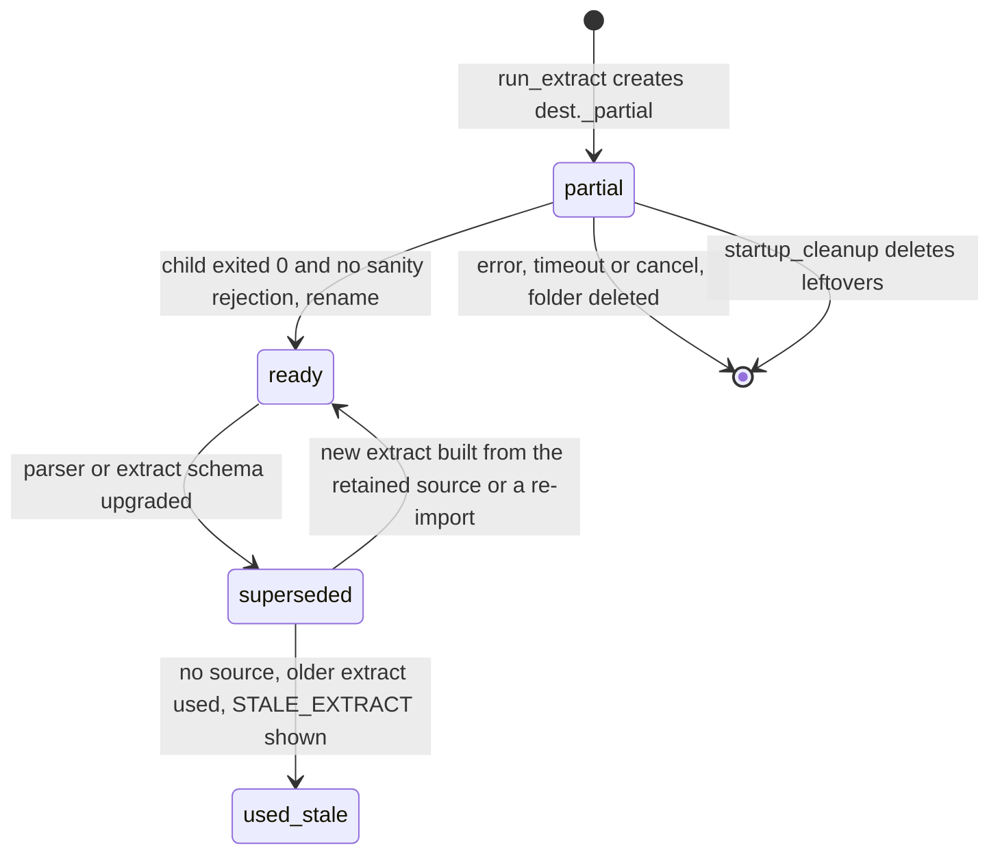
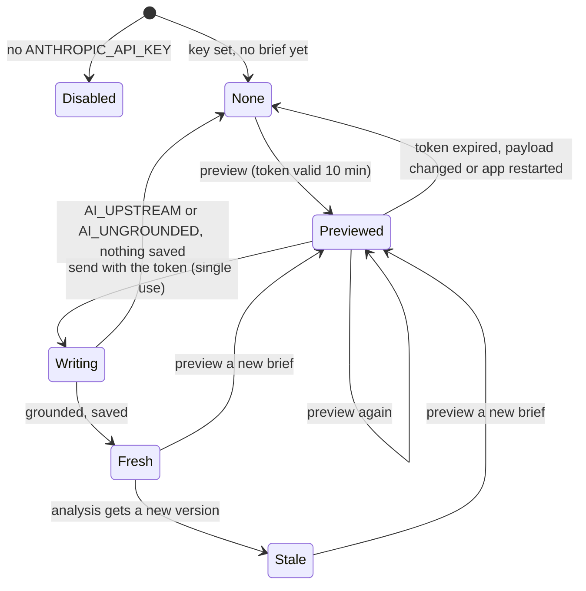

# State machines

The lifecycle of each thing the app keeps. Each chart names the code that moves it between
states.

## Job

Table `job`, code `jobs/runner.py`. The page polls `GET /ui/jobs/{id}` every second.

## Entry version

Table `entry_version`, folders `entries/{id}/v{n}/`, code `Library.begin_version`,
`commit_version`, `abandon_version`.

Only `current` and `previous` are kept on disk.

## Analysis freshness

What the entry page shows. Code `web/pages.py` (`entry_page`).

`Outdated` means the version has no `patterns.json`, its `schema_version` is below
`core.findings.SCHEMA_VERSION`, or its `config_hash` differs from the saved thresholds. When
findings or round stories change, bump `SCHEMA_VERSION` so older analyses land here.

## Imported file

One row in the import report. Code `jobs/import_job.py`. The full decision tree is in
[Import](import.md#what-happens-to-each-file).

## Extract

Folders `extracts/{sha}/{parser}@{version}+s{schema}/`, code `jobs/extract_worker.py`.
Extracts are never changed after they are written.

## AI brief

Code `web/api.py`, `ai/confirm.py`, table `ai_brief`.

A stale brief still shows in the app, marked as stale. The export leaves it out.
