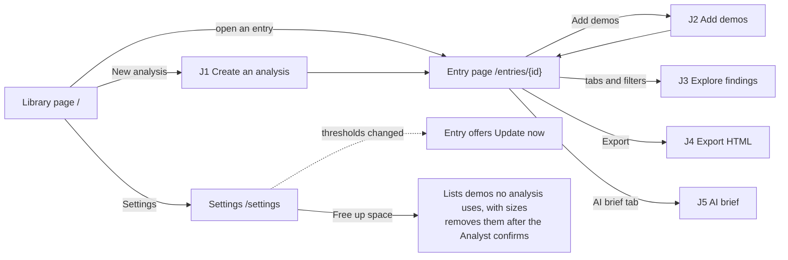
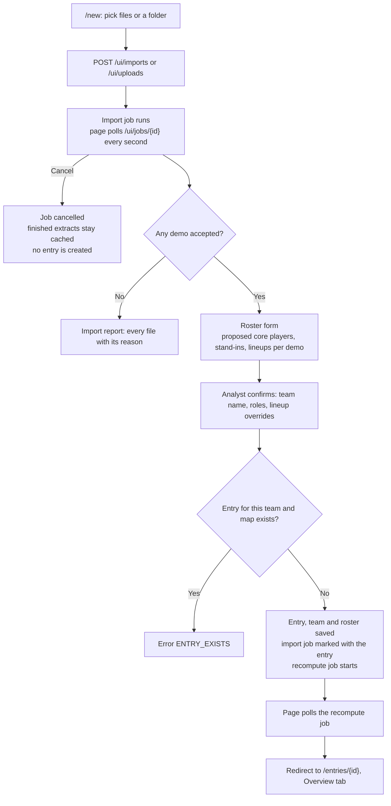
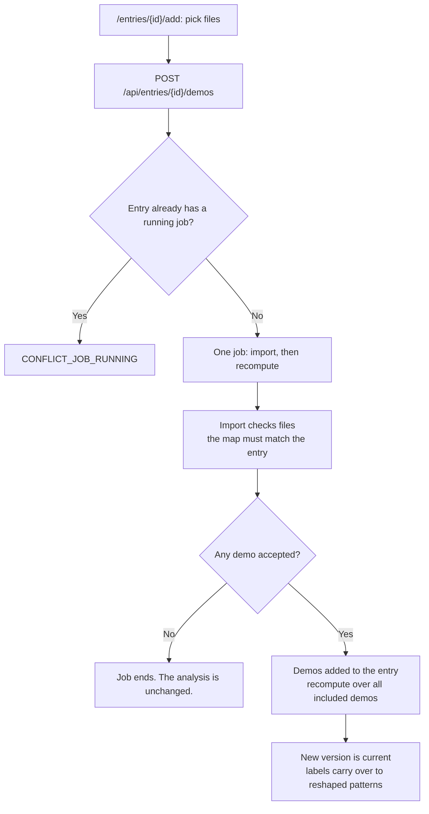
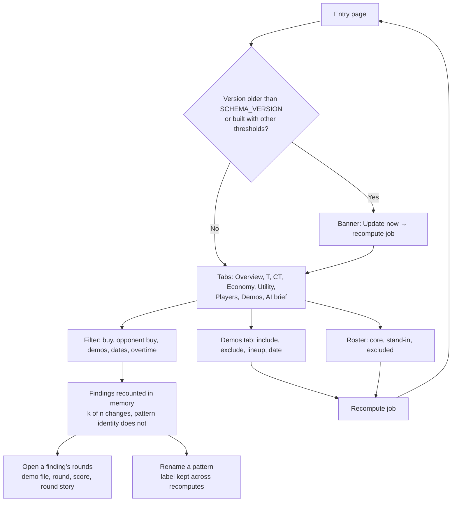
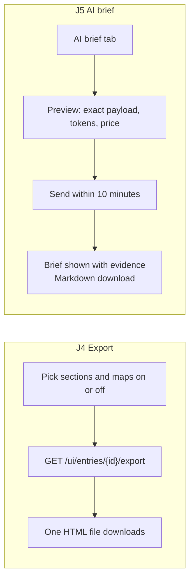

# User journeys

What the Analyst does, page by page. The journeys J1–J5 are defined in the
[requirements](../product/requirements.md#3-core-journeys).

## Overview

## J1: Create an analysis

The import job parses the demos before the Analyst sees the roster. So the roster form can
show who played in each demo. The recompute then reads only the cached extracts.

## J2: Add demos

## J3: Explore findings

Other changes on the entry page also start a recompute: include or exclude a demo, set a
demo's lineup or date, or edit the roster.

## J4 and J5

These are short from the Analyst's side. The detail is in
[AI brief and export](ai-brief-and-export.md).

